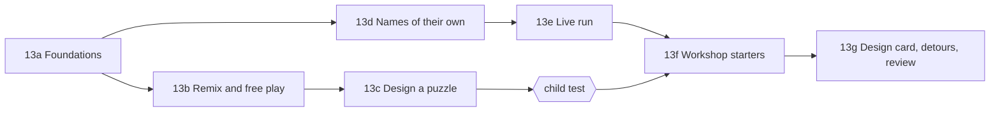

# Creation mode: build plan

This is the plan for build step 13 of [plan.md](plan.md), written on
2026-11-11 after step 12 finished the concept spine. plan.md section 9
already says *what* creation mode is: four sizes (remix, design a puzzle,
modify a game, design your own game), open at any time, local-first, a
grown-up reviews anything shared, and no AI until step 14. This document
says *how* to get there from the code as it stands, in what order, and which
decisions are still the owner's.

## 1. The short version

Creation splits cleanly into two halves, and they cost very different
amounts.

- **Puzzle creation (remix, design a puzzle)** needs no change to the
  engine. The world is already data, the editor is already driven by a
  `programming` object, the validator already runs headless, and the parser
  already takes untrusted JSON. What is missing is a board editor, somewhere
  to keep a child's work, and a way in. This is steps 13a to 13c.
- **Game creation (the Workshop, design your own)** needs the engine to grow.
  Today a run is computed whole and then played back; keys are a script
  written before the run. A game needs a run that stays alive and answers
  the player. It also needs the things deferred "to creation mode" in the
  design notes: names the child chooses, records that are built, robots that
  act together. This is steps 13d to 13g.

The recommendation is to build the puzzle half first and put it in front of
a child before starting the game half. It is the bridge plan.md calls the
key one, it is nearly all reuse, and it produces the storage, the shell and
the board editor the Workshop also stands on.

## 2. What is already there, and what is not

| Need | Already built | Missing |
| --- | --- | --- |
| A board a child can change | `WorldDefinition` is plain data; `Board` takes `onTileTap` and turns every tile into a button (used by prediction) | A board editor: tools, entity placement, resize, undo |
| A program editor with every card | `Editor` plus `paletteFor(programming, program)`; a permissive `programming` object opens every card | Children cannot add a function, a When card or a memory slot of their own; the level supplies them |
| An honest critic | `validatePuzzle` and `shortestSolution` are pure and headless; they prove solvability, find the shortest flat program and warn when a flat program fits the budget | They run only in CI. They need to run in the Worker with a time limit, and their messages are written for authors, not children |
| Loading a level that is not in the bundle | `parsePuzzle` validates unknown JSON with path-precise errors | Levels come only from `import.meta.glob` at build time; hints and `curriculum` are required fields |
| Keeping work | `KeyValueStore` over IndexedDB with `progress`, `settings`, `log` | No store for creations; an unfinished program is not saved even in a lesson |
| A way in | Hash routes, the map | No Create entry, no shelf of the child's things |
| A reusable play surface | `Lesson.tsx` holds board, editor, run controls and the lesson flow in one 700-line component | The board-editor-run part needs lifting out so remix and the Workshop can use it |
| Live play | The interpreter is a generator; the runtime contract is message-passing | A run is one request and one whole trace; input is `inputScript`; there is no clock |
| Game rules | Reach the flag, collect all, memory equals, covers | Win and lose decided by the program; tapping a tile as input; drawing a grid slot on the board |
| Gap detection | The concept graph in each `pack.json`; `cardsTeaching` maps some concepts to cards | The map from every card to the pack that teaches it is incomplete |

## 3. Principles for this step

These follow plan.md section 2 and are restated because each one settles a
design question below.

1. **A creation is data, never code.** A child's puzzle or game is a world
   plus an IR program plus rules, in versioned JSON, read back through the
   parser. Nothing a child makes is executed except by the interpreter,
   under its limits.
2. **One engine.** Lessons, remixes and games run on the same simulation,
   interpreter, printer and board. A feature the Workshop needs goes into
   the engine with tests, not into a second engine beside it.
3. **Same input, same trace, still.** A live game records its key presses
   and its seed. Replaying the recording gives the same trace. That keeps
   games testable, lets a child watch a replay, and lets the validator check
   a starter game.
4. **Nothing is blocked, everything is signposted.** Every card is available.
   A card from an unplayed pack carries a link to that pack.
5. **The child makes it.** No generation, no auto-solve. The critic says what
   is true about the puzzle and never fixes it.
6. **Each sub-step ends runnable on an iPad**, as in section 10 of plan.md.

## 4. The build sequence

### 13a. Foundations: a shelf, a way in, a shared play surface

Nothing a child can show a friend yet, but everything after stands on it.

- **Lift the play surface out of `Lesson.tsx`.** A `PlaySurface` component
  owns board, editor, run controls, memory card, sequencer and code panel,
  and takes a world, a `programming` object and callbacks. `Lesson` becomes
  the lesson flow around it (intro, prediction, hints, stars). No behaviour
  changes; the existing editor and lesson tests are the proof.
- **A creation store.** `src/create/store.ts` over the existing
  `KeyValueStore`: one key per creation (`creation:<id>`) plus an index key,
  so one large game does not rewrite everything. The record:

  ```ts
  interface Creation {
    schemaVersion: 1;
    id: string;                 // local id
    kind: 'puzzle' | 'game';
    title: string;
    madeBy?: string;            // a nickname, never an account
    basedOn?: string;           // level id or starter id it was remixed from
    createdAt: number; updatedAt: number;
    world: WorldDefinition;
    objective: ObjectiveDefinition;
    programming: Programming;   // the palette and limits the maker chose
    program: NodeSpec[];        // the maker's own program, saved as they go
    proof?: { solution: NodeSpec[]; steps: number; provedAt: number };
    status: 'draft' | 'proved';
  }
  ```

  A `parseCreation` beside `parsePuzzle` reads it back, reusing the world,
  objective and program parsers. It is a looser shape than
  `PuzzleDefinition`: no hints, no `curriculum`, no stars. A small adapter
  turns a proved creation into what `PlaySurface` plays.
- **Save-my-place.** Creations autosave on every edit. The same mechanism
  saves an unfinished lesson program per level, which lessons lack today and
  which the detour loop needs.
- **Routes and the door.** `#/create` (the shelf: "My things" and the four
  ways to start), `#/create/<id>` (edit), `#/play/<id>` (play a proved
  creation). The map gets a Create button that is always there, with the
  quiet nudge of section 6 below.
- **Tests:** store round-trip, parser rejects bad creations with a path,
  routes, and the lesson tests still passing over the lifted surface.

### 13b. Remix and free play

The first thing a child can make: take a level, change it, solve it.

- **Board editor** (`src/create/BoardEditor.tsx`) on top of `Board` and
  `onTileTap`. A tool strip: floor, rock, water, acorn, flag, robot (tap
  again to turn it), eraser. Tap to place, drag to paint, resize handles on
  the board's edges up to the 16 by 16 the coordinate cards allow. World
  edits are pure operations with their own undo history, built the way
  `ir/ops.ts` and `ir/history.ts` are for programs.
- **Entities in the order the packs teach them.** First cut: tiles, acorns,
  flag, robot. Then gates and switches with a "which gate" picker, plates,
  logs and beetles with a path drawn by dragging. Each tool is signposted to
  its pack, like the cards.
- **Two modes on one screen: Build and Play.** Build edits the board; Play
  is the ordinary `PlaySurface` with every card open. Switching is one tap,
  and the program survives the switch.
- **Remix** is a button on a finished level's success strip and on the
  shelf: "Change this level". It copies the level's world and palette into a
  new creation with `basedOn` set. **Blank board** is the same editor
  starting from an empty 5 by 5.
- **The world checker runs live.** The board rules already in the validator
  (robot on floor, flag reachable in principle, mover paths legal) run on
  every edit and mark the problem on the board in kid terms ("The robot is
  standing in water").
- **Tests:** world operations and undo, board-rule messages, remix copies
  and does not alter the original.

### 13c. Design a puzzle, with the validator as critic

A remix becomes a puzzle for someone else.

- **The maker sets the challenge:** which cards the player gets, the budget,
  the goal (reach the flag, collect every acorn, or both). The palette
  chooser is the palette itself with cards toggled on and off.
- **Prove it.** A puzzle is offered to others only after its maker solves it
  under its own limits. That solution is stored as the proof. This is the
  rule that keeps impossible puzzles off the shelf, and it needs no search.
- **The critic.** `validatePuzzle` and `shortestSolution` move behind the
  runtime contract and run in the Worker with a time limit. The critic
  reports, in kid terms, three things the validator already knows:
  - "Your puzzle can be solved in 7 cards. Your budget is 12."
  - "A player can solve this without Repeat." (the flat-program warning)
  - "Nobody can solve this with these cards." (before the proof)

  When the search runs out of time on a big board, the critic says only
  what the proof shows. It never proposes a change.
- **Playing it.** Proved puzzles appear on a "Made here" island on the map
  and at `#/play/<id>`, with the maker's nickname. A player earns a star
  for solving and a second for matching the maker's card count. Results go
  to the observation log, so the grown-up's export shows creations too.
- **Other kinds of puzzle, later in this step.** "Hide a bug" (the maker
  solves it, then changes one card: a debug level) and "Where will it stop?"
  (a predict level) fall out of activity promises the validator already
  checks. They are a strong learning exercise and cheap; they are not needed
  for the first cut.
- **Tests:** critic messages for each case, the time limit, a proof is
  rejected when the limits change after it was made.

**Built 2026-11-11** (13a, 13b and 13c; see design-notes.md for what
differs from this plan).

**Stop here and test with a child.** Steps 13a to 13c are a complete
feature. The questions for the test: does a child find Create unprompted,
can they make a puzzle someone else can solve, do they read the critic, and
does making a puzzle send them back to a pack they skipped?

### 13d. Names of their own

**First part built 2026-11-11:** naming functions, memory and When cards,
plates, beetles and logs on the board, and kits of ready-named parts.
Records that are built, a function calling a function, and `not` remain
(design-notes.md).

The design notes defer four things to creation mode. They are small, and
both the free-play editor and the Workshop need them.

- **A child names things.** Add a function, add a memory slot and choose its
  kind, add a When card for an event on the board. Names come from an
  on-screen name field with a rule: letters and digits, starts with a
  letter, not a card's name, not already used. The printer already needs
  legal identifiers, so the rule is the identifier rule said kindly.
- **Records are built**, not only read: a Set card for a field, and a "new
  record" source for lists of records.
- **A function may call a function**, with the interpreter's existing depth
  guard. Recursion stays out: a function cannot call itself, directly or
  round a loop, and ops reject it as they reject nested calls now.
- **Conditions grow by one:** `not`. `and` and `or` wait until a starter
  game proves it needs them.

Each of these touches the IR, ops, the editor, the printer, the interpreter
and the parser, with tests in each, exactly as a concept pack did.

### 13e. The live run

The engine change the Workshop depends on. It is worth a spike before the
rest of 13e to 13g is committed to.

- **A session beside a run.** The contract gains `start`, `input` and `stop`
  messages. The host keeps the interpreter generator alive, advances it one
  turn at a time and streams trace events as they happen. The existing
  one-shot `run` stays for lessons and the validator.
- **A clock.** On a real-time game the host ticks on a timer (a few ticks a
  second, set by the game). On a turn-based game nothing moves until the
  player acts. Each turn has its own step budget, so one bad handler cannot
  hang the game; the forever-loop guard applies per turn.
- **Input.** Arrow keys and an on-screen pad feed `key:` events, which exist.
  A new `tap` event carries the tapped tile as a position, which turn-based
  games need.
- **Recording.** The session logs each input with the tick it arrived on,
  and the seed. Feeding the log to the one-shot `run` reproduces the trace.
  This is the test harness for every starter game and gives "watch that
  again" for free.
- **Robots at once.** On a live board, every actor takes one action per
  tick. This is the simultaneous team the Robot team notes put off.
- **The board streams.** The controller animates events as they arrive
  instead of from a finished trace; the sequencer's step and pause still
  work between turns.

### 13f. The Workshop: starter games

A starter game is a creation of kind `game`: a world, a program made of When
cards and functions, memory, and rules. It is content, in
`content/starters/`, validated in CI by replaying a recorded play to a win.

- **What games need beyond 13e:**
  - **Win and lose cards.** The program ends the game ("You win", "Game
    over") instead of a fixed objective.
  - **A grid slot drawn on the board.** A grid in memory can be shown on the
    tiles (marks, numbers, covered and uncovered). This is what lets
    noughts and crosses and minesweeper exist without a new renderer.
  - **Other actors with a program.** A beetle that runs a blueprint each
    tick, in place of a fixed path.
  - **Persistence for real.** A `keep` slot in a game is written to the
    creation store, so a high score is there tomorrow. This is Overnight
    made literal.
- **Which games.** Stay on the grid for step 13. Proposed, two per family:

  | Family | Starter | Why this one |
  | --- | --- | --- |
  | Real-time | Crossing (Frogger-like) | Logs, beetles, keys and ticks already exist; smallest step from Tick tock |
  | Real-time | Acorn chase (Pac-Man-like) | Adds a chaser with its own program and a score |
  | Turn-based | Noughts and crosses | Tap input, a grid as the board, turns, a win check |
  | Turn-based | Minesweeper | Hidden information and randomness; Reading the map already ends on it |

  Connect 4 is a good third. Solitaire and Q\*bert do not fit a square grid
  and wait for a decision on non-grid boards (section 7).
- **Modify, then make.** Each starter opens with three or four suggested
  changes of rising size ("make the logs faster", "add a second life", "the
  beetle chases you"). Every part of the game is editable; the suggestions
  are a ladder, not a fence.
- **The known hard part: win checks.** "Three in a row" written from cards
  is long, and the card language has no arithmetic beyond counting. The
  plan is to give the starter a ready, readable `lineOfThree` function the
  child can open and change, and to add a sense card only if testing shows
  children cannot follow it. This needs a paper prototype before it is
  built.

### 13g. The design card, detours and grown-up review

- **The design card is a view of the program's skeleton**, not a separate
  document. Its three questions map onto the IR:

  | The card asks | It creates |
  | --- | --- |
  | What must the game know? | Memory slots, with their kinds |
  | What changes it? | Empty When cards and functions |
  | What must still be there tomorrow? | `keep` on those slots |

  Filling in the card lays out empty, named parts; the child then fills
  them. The card and the program cannot drift apart because the card is
  read from the program.
- **Gap detection by rules.** Complete the map from every card, source and
  board tool to the pack that teaches it. When a creation uses one from an
  unfinished pack, show a quiet link: "The robot learned this in Overnight."
  Following it saves the place (13a), opens the pack, and offers the way
  back on the map and at the end of each level. This is the rules half of
  step 14 and gives the AI guide something exact to stand on.
- **Grown-up review.** Behind the existing grown-up settings: see
  everything made on the device. Sharing a creation off the device, by file
  or otherwise, is not in this step (section 7); it waits for profiles and
  a server.

## 5. Order and dependencies



13d and the 13e spike can run alongside 13b and 13c, since they touch the
IR and the runtime and not the creation screens. 13f should not start
before the child test of the puzzle half.

## 6. Decisions this plan makes

These answer open items in plan.md section 12. Each is a default, recorded
here so it can be overruled.

- **The nudge is a quiet note.** The Create screen shows one line, "Next
  island: Keep count", with a button. No suggested path, no counter of
  unfinished packs.
- **Detours are suggested, never required.** A signpost on the card and on
  the design card; nothing is locked.
- **The Workshop is part of creation mode**: the part for games. Puzzles
  made by children live on the shelf and on the "Made here" island.
- **Grid only in step 13.** Every starter game fits square tiles.
- **A puzzle is offered to others only once its maker has solved it.**
- **No AI in this step.** Gap detection is rules; step 14 adds the
  conversation.

## 7. Decisions by the owner (2026-11-11)

1. **The puzzle half (13a to 13c) is the first release of creation mode,**
   tested with a child before the Workshop is started.
2. **Starter games:** Crossing, Acorn chase, Noughts and crosses and
   Minesweeper.
3. **No file export or import in step 13.** Sharing beyond the device waits
   for profiles and a server. The grown-up's export in Settings still
   includes what the child made, as a backup.
4. **Names are typed** on the on-screen keyboard, with the rule in 13d.
5. **One maker per device for now.** Profiles are later work.

Still open: non-grid games (solitaire's cards, Q\*bert's pyramid), which
stay out of step 13 until a child asks for one.

## 8. Risks

- **The live run is the largest change since the vertical slice.** It
  touches the contract, the host, the controller and the sequencer. The
  recording rule (principle 3) is what keeps it testable; the spike in 13e
  should prove it before the Workshop is designed around it.
- **The card language may be too small for game rules.** Win checks,
  scoring and collisions press on a language with no arithmetic and no
  `and`. 13f adds only what a named starter game needs, one card at a time,
  each with its tests and its line in the card book.
- **The critic can be slow.** The flat search is bounded and a 16 by 16
  board with gates is large. The time limit and the maker's proof mean the
  critic can always say something true.
- **`Lesson.tsx` is load-bearing.** Lifting `PlaySurface` out is a refactor
  of the most-used screen. It goes first, alone, with no feature attached.
- **Storage.** IndexedDB can be cleared by the browser on an iPad that is
  short of space. The settings export includes creations so a grown-up can
  back them up.

## 9. Not in this step

A general game builder, physics, a sprite or art editor, sound editing, AI
of any kind, accounts, an online gallery, loading packs from a URL, and
editable TypeScript. These are as plan.md section 9 leaves them.
