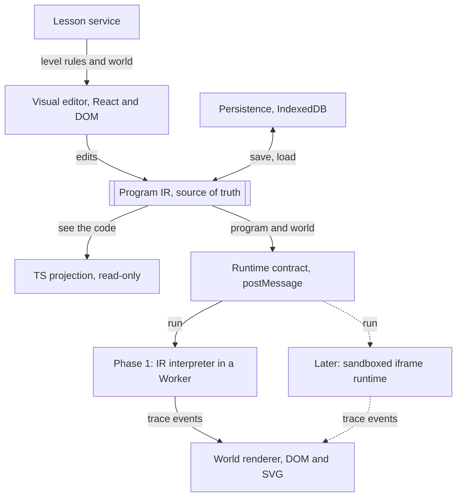
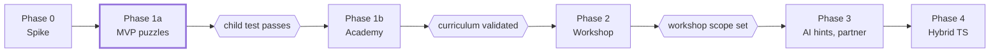

# Visual-First Programming: Revised Product and Technical Plan

> This file is the master copy of the plan. The Claude Doc it started as has
> been retired. Build progress is tracked in [design-notes.md](design-notes.md),
> not here. Revised 2026-11-05: the board is top-down 2D, not isometric.

## Decision summary

Build a polished top-down 2D robot-puzzle MVP first, with a visual program IR as the single source of truth and TypeScript shown as read-only "see the code". Validate puzzle play with the first child tester before writing the full curriculum, Game Workshop, or AI features.

Purpose: approve the product direction and the Phase 1 boundary before handing work to coding agents. This is a personal project for a nephew first; it may later be open-sourced or offered online, so the architecture keeps those doors open without building for them now.

**What changed from the review draft**

| Area | Review draft | Revised plan |
| --- | --- | --- |
| Source of truth | Annotated TypeScript files with a limited decoder | Visual IR is authoritative through Phase 3; TypeScript is a deterministic read-only projection |
| Phase 1 execution | Compile and run TypeScript in a Worker | Interpreter over the IR; no TypeScript execution until Phase 2 or later |
| Runtime boundary | Worker, with a note that it is not a security boundary | Message-passing runtime contract from day one, so a cross-origin sandboxed iframe drops in later |
| View | 2.5D isometric board | Top-down 2D grid with square tiles; one robot sprite rotated in code for all four facings |
| Turn commands | Turn left, turn right | Rotate clockwise, rotate counter-clockwise, with on-screen rotation cues |
| Renderer | Phaser | DOM and SVG board with CSS animation; a canvas layer only if effects need it |
| Art | Unspecified owner | AI-generated art from a prompt list in this plan, vector style matching the concept sketch |
| Reordering | Menu move up/down, drag optional | Tap a card, tap a slot, as the primary design |
| Phase 2 | Reusable visual editor for game templates, events and game state | Pared back to a modest step up from puzzles; scope defined after MVP validation |
| Phase 3 AI | Structured operations on gameplay | AI hints first; AI output is IR operations, never TypeScript |
| Curriculum | 12 levels fully specified up front | An MVP puzzle set to validate play; the full curriculum is written after validation |
| Missing features | Not listed | Prediction mode, hint ladders, level map with stars and badges, observation logging |

## 1. Decisions approved

| Decision | Position |
| --- | --- |
| Product progression | Puzzle Academy, then a modest visual Game Workshop, then AI hints growing into an AI creative partner, then a hybrid TypeScript editor. |
| First release | An MVP set of sequencing puzzles using Forward, Rotate CW and Rotate CCW. No loops or conditionals. The full curriculum is written only after MVP puzzle play is validated with a child. |
| Visual standard | Original, polished top-down 2D art, robot animation, sound and interaction feedback in the first child-facing build. Art is AI-generated from the prompt list in section 3. |
| Program model | A versioned visual IR is the executable source. TypeScript is a deterministic read-only projection shown as "see the code". Hand-edited TypeScript arrives in Phase 4. |
| Execution | A deterministic interpreter over the IR produces a bounded trace. No TypeScript compilation or execution in Phase 1. |
| Runtime contract | Runtimes receive a program and world and emit trace events over message passing. Phase 1 runs in a Worker; later untrusted code runs in a cross-origin sandboxed iframe behind the same contract. |
| Rendering | DOM and SVG top-down grid board with CSS animation. No game engine in Phase 1. |
| Cross-platform | Browser-based responsive PWA for iPad, Android tablets, Mac, Windows and Chromebook. Local-first, no accounts. |
| Content model | Logical tiles, actors, themes and lesson constraints defined by data, not hardcoded per level. |
| Editor interaction | Tap a card, tap a slot. Every essential action works with tap and keyboard. Drag is never required. |
| Meta-loop | Level map, stars per level and badges for mastery behaviours. No leaderboard. |

## 2. Product principles

- Learning should feel like a satisfying game. Worlds, animation, sound and feedback are fundamental UX, not launch polish.
- One new concept at a time. Limit choices at first; later use instruction budgets to motivate abstraction.
- Predict and debug, not merely brute-force. Require varied evidence of understanding, not only reaching the goal.
- Create before typing. Children build and modify games visually, with AI help, before text programming.
- No dead-end language. Every visual program has a real TypeScript form the child can read now and edit later.
- Tablet-first interactions. Tap and keyboard cover everything; drag is an enhancement.
- Validate before expanding. No curriculum, workshop or AI work until the MVP puzzle loop is proven with a child.

## 3. Visual direction, theme system and art pipeline

The board is a top-down 2D grid of square tiles, seen from directly above. Isometric was dropped because it multiplies the art: every object needs a 2:1 projection, depth sorting, and four facings with a full pose set each. Top-down needs one drawing per object, and the robot is drawn once and rotated in code.

Aim for a recognisable, kid-friendly adventure-game feel: bright readable tiles, a personable robot whose facing is obvious at a glance, subtle world motion, a clear goal marker, and crisp response to every command. The concept sketch's clean flat-vector style still sets the palette and character; it reads well at tablet size and suits SVG delivery.

**Facing and rotation cues**

- Up on the screen is north, and it never changes. Rotate CW turns the robot clockwise on screen, exactly as the word says, which removes the projection confusion isometric risked.
- The robot is drawn pointing up, with an unmistakable front: a headlamp, a nose arrow, or a visor. Code rotates the same sprite 90 degrees per turn.
- A curved arrow shows the direction of rotation during the turn. A forward indicator on the tile ahead shows where Forward will land, and turns red when the move is blocked.
- Fixed camera, no scrolling, no zoom in early puzzles. Every tile is visible at once.

**Theme architecture**

- Separate semantics from presentation. Floor, wall, gap, goal, collectible, hazard, switch and gate are logical elements; each theme maps them to art, sound and effects.
- Render terrain, overlays, entities and transient effects as separate DOM or SVG layers. Collision, pathing and goals never depend on assets. With no depth sorting, layer order is fixed: floor, overlays, items, robot, effects.
- A theme pack holds SVG or PNG assets, a palette, tile variants, effects, ambient sound and animation timing. One fully polished forest theme plus one small frozen-theme proof.
- Theme swapping preserves the same solution and rule evaluation; animations never change simulation outcomes.

**Asset specification for AI generation**

Every asset is a square, viewed from directly above, on a transparent background, at 256 by 256 px and scaled down in the app. Square top-down tiles are the format image generators handle most reliably.

| Asset | Count | Notes |
| --- | --- | --- |
| Floor tile | 3 variants per theme | Full square, edges tile seamlessly with each other |
| Wall tile | 2 variants per theme | Fills the square; reads as solid and impassable from above |
| Gap tile | 1 per theme | Water, chasm or void; clearly not walkable |
| Goal marker | 1 per theme | Flag or beacon seen from above, centred, about half the tile |
| Collectible | 1 per theme | Small, centred, readable when the robot is beside it |
| Props | 3 to 4 per theme | Decoration for wall tiles: tree canopy, boulder, stump |
| Robot | 1 sprite pointing up, plus 3 expression variants | Neutral, happy and oops faces; rotation and movement are done in code |
| Effects | 3 | Success sparkle, bump puff, step dust; simple 4 to 6 frame sheets |
| UI icons | 8 | Forward, Rotate CW, Rotate CCW, Run, Step, Reset, Undo, Hint |

Generate the robot first, then everything else against it, so the set matches. Expect light cleanup: trim to the square, fix transparency, and check that floor tiles meet without a visible seam.

**Prompt list for ChatGPT image generation**

Use the shared style prefix on every prompt so the set stays consistent.

Style prefix: "Flat vector illustration for a children's game, top-down orthographic view seen from directly above, no perspective, clean geometric shapes, soft pastel palette, subtle shading, no outlines, no text, no watermark, transparent background, square 256 by 256 image, subject centred, light from the upper left."

1. Robot: "[prefix] A small friendly round robot seen from directly above, pointing straight up toward the top of the image. Blue round body, a lighter blue dome in the centre, a bright yellow headlamp at the front edge so the front is obvious, two small stubby arms on the sides. Symmetrical left to right."
2. Robot expressions: "[prefix] The same blue round robot seen from directly above, pointing up, three versions side by side: neutral, happy with a sparkle, and oops with a small spark. Only the dome's face and glow change."
3. Forest floor tiles: "[prefix] Three square grass tiles that tile seamlessly, fresh green with a few small flowers or pebbles, each a slightly different pattern, no border."
4. Forest wall tiles: "[prefix] Two square tiles filled by mossy grey rock seen from above, clearly solid and raised, with a soft shadow along the bottom and right edges."
5. Forest gap tile: "[prefix] One square tile of dark blue pond water with a few ripples and a grassy rim, clearly not walkable."
6. Forest goal marker: "[prefix] A small yellow flag on a pole seen from directly above, the flag cloth spread out to one side, standing on a grass tuft, centred, about half the tile wide."
7. Forest collectible: "[prefix] A single shiny golden acorn seen from above with a soft glow, small, centred."
8. Forest props: "[prefix] Four separate square images seen from directly above: a round green tree canopy, a pine tree canopy, a mossy boulder, a tree stump with mushrooms. Each fills most of its square."
9. Frozen floor tiles: "[prefix] Three square ice tiles that tile seamlessly, pale blue with faint crack lines and a frosted sheen, no border."
10. Frozen wall and gap tiles: "[prefix] Two square tiles filled by snowy rock seen from above, clearly solid, and separately one square tile of dark icy water, clearly not walkable."
11. Frozen goal and collectible: "[prefix] A light-blue flag on a pole seen from directly above on a snow tuft, and separately a single glowing snowflake crystal, each centred."
12. Effects: "[prefix] Three short sprite sheets, six frames each in a horizontal row, seen from above: golden sparkle burst, small grey puff of dust, soft footstep dust ring."
13. UI icons: "[prefix] Eight rounded square app icons in one consistent set: straight up arrow (forward), clockwise curved arrow, counter-clockwise curved arrow, play triangle, single-step footprint, circular reset arrow, undo arrow, lightbulb hint. Bold simple shapes readable at 44 pixels."
14. Level map backdrop: "[prefix] A forest island seen from directly above with a winding path and fifteen evenly spaced round stepping stones along it, space beside each stone for stars, no text."
15. Badge set: "[prefix] Six round achievement badges in one consistent style: a crystal ball (prediction), a wrench (debugging), a compass (navigation), a lightning bolt (efficiency), a map (transfer), a trophy (mastery). Flat vector, gold rim."

**Phase 1 visual-quality gate**

- Robot has expressive idle, move, rotate, success and error states with consistent timing.
- Its front is obvious at every rotation, at tablet size, without reading any text.
- Tiles, walls, gaps and goals are visually distinct at tablet size. Floor tiles show no seams.
- Audio and particles reinforce actions but are never required signals; muted audio and reduced motion are supported.
- No placeholder art in the child-facing build. A small finished world beats several unfinished worlds.

## 4. Learning design

The MVP validates one thing: can a novice fourth grader understand, build, repair and predict short sequential programs on a grid board without verbal coaching. The full curriculum is written after that is answered.

Use PRIMM (Predict, Run, Investigate, Modify, Make), Parsons-style ordering tasks, and worked examples with gradually removed scaffolding. Apply them as varied activity types, not as five compulsory steps in every level. Evidence for PRIMM exists in secondary settings; primary-school application is promising but less established, so direct usability validation is required.

**MVP puzzle set: 15 sequencing levels**

Rotation enters at level 3 so the facing question is tested early. Collectibles enter at level 9 to extend sequencing without new constructs and to give the competitive tester something to optimise.

| Levels | Activity | Commands | Purpose |
| --- | --- | --- | --- |
| 1 to 2 | Run one prepared Forward; tap the tile where the robot will land | Forward | Execution correspondence and the first prediction |
| 3 to 4 | Add one move to reach the goal in two steps | Forward | Assemble in order |
| 5 to 6 | Rotate once, then move | Forward, Rotate CW, Rotate CCW | Facing and rotation cues |
| 7 to 8 | Reorder supplied cards into slots | Forward, Rotate CW, Rotate CCW | Parsons task, tap-a-card-tap-a-slot |
| 9 to 10 | Navigate a corner and pick up one collectible | Forward, Rotate CW, Rotate CCW | Independent sequencing with a sub-goal |
| 11 to 12 | Find and repair one wrong instruction in a pre-filled program | Forward, Rotate CW, Rotate CCW | Debugging |
| 13 | Predict the final tile and facing before running | Forward, Rotate CW, Rotate CCW | Transfer task on a visually different board, no hint by default |
| 14 | Complete a route with two collectibles from an empty program | Forward, Rotate CW, Rotate CCW | Independent construction |
| 15 | Same route under a tight instruction budget | Forward, Rotate CW, Rotate CCW | Efficiency; sets up the motivation for Repeat |

Level numbers and thresholds are a test hypothesis. No level contains loops, conditions, variables or functions.

**Prediction mode**

A level can open in prediction mode before Run is enabled. The child taps the tile where the robot will finish and, on later levels, picks the facing with a rotation chip. The board then runs and compares. A wrong prediction is never a failure; it opens the investigate step with the trace highlighted.

**Hint ladders**

Each level authors a deterministic three-rung ladder: orient attention (highlight the relevant board region), identify the instruction (highlight the step that matters), partial scaffold (fill one slot). The solution is never given. Hint requests are logged per level.

**Mastery evidence**

- Measure prediction accuracy, debugging success, independent construction and transfer; do not equate trial-and-error completion with mastery.
- Keep instruction efficiency optional during basic mastery. Hard caps only on levels with a verified solution and a teaching purpose.
- Stars per level: one for completion, one for no hints, one for within budget. Badges for behaviours across levels, listed in section 8.

**Curriculum after validation**

Repeat, motivated by an instruction budget the child has already felt on level 15. Then conditionals that depend on variable world state, then variables, functions and events. Introduce a construct only after a concrete puzzle makes the previous approach cumbersome. This section is written in full only after the MVP child test passes.

## 5. Puzzle rules and lesson schema

Each level declares its allowed instructions, maximum total instruction nodes, optional per-command quotas, starter program, goals, prediction settings, hint ladder, scoring and teaching activity. The editor hides irrelevant commands and shows remaining capacity.

```typescript
interface PuzzleDefinition {
  id: string;
  themeId: string;
  world: WorldDefinition;            // tiles, walls, collectibles, start pose
  objective: ObjectiveDefinition;    // reach goal, collect all, final facing
  curriculum: { concept: string; activity: 'run' | 'build' | 'reorder' | 'debug' | 'predict' };
  programming: {
    allowedCommands: CommandId[];
    maxInstructions?: number;
    maxPerCommand?: Partial<Record<CommandId, number>>;
    maxNestingDepth?: number;        // unused until Repeat
    starterProgram?: IRNode[];
    suppliedCards?: CommandId[];     // Parsons levels
  };
  prediction?: { askTile: boolean; askFacing: boolean };
  hints: [HintStep, HintStep, HintStep];
  referenceSolution: IRNode[];       // required on every level
  stars: { noHints: boolean; budget?: number };
}
```

Instruction count means program nodes, including a Repeat node and its body later, not runtime actions. Executed operations are reported separately.

Validators run in CI on every level: the reference solution reaches the objective within the declared limits; for sequencing levels an exhaustive search confirms the minimum instruction count used for the budget star; allowed commands cover the reference solution; hint targets refer to real steps and tiles.

## 6. Visual editor and interactions

The program is an editable vertical sequence of instruction cards with insertion slots. Early levels present fixed slots; later levels reveal insertion, nesting and parameters. A contextual command palette shows only the commands the level permits. The board and the program are visible together on landscape tablets and desktops; portrait tablets stack board over editor with a compact command drawer.

**Tap a card, tap a slot**

Selection is the primary model for every placement and move. The child taps a card in the palette or in the program; it lifts and the valid slots glow. Tapping a slot places it. Tapping the same card again, or anywhere else, cancels. Moving a card within the program is the same gesture: tap the card, tap the destination slot. Drag is an enhancement layered on the same slots and is never required.

| Interaction | Touch and mouse | Keyboard |
| --- | --- | --- |
| Add step | Tap a palette card, tap a slot | Focus palette card, Enter, arrow to slot, Enter |
| Move step | Tap a program card, tap a slot | Focus card, Space to lift, arrow to slot, Space |
| Reorder supplied cards (Parsons) | Same tap-card-tap-slot gesture | Same keys |
| Delete | Tap card, tap the trash slot | Focus card, Delete |
| Undo and redo | Toolbar buttons | Cmd or Ctrl+Z, Shift+Cmd or Ctrl+Z |
| Run, step, pause, reset | Toolbar | Cmd or Ctrl+Enter runs; toolbar is keyboard reachable |
| Predict | Tap a board tile; pick a facing chip | Arrow across tiles, Enter; Tab to facing chips |
| Hint | Tap the lightbulb | H |
| See the code | Toggle panel | C |
| Nest (later) | Tap a Repeat card, tap a slot inside it | Arrow right and left to enter and leave |

Minimum hit targets are 44 by 44 CSS px. No essential function is hover-only. Every card and slot is a real DOM element with a label, so screen readers and keyboard focus work without extra work.

**Execution model**

Every executed instruction emits a typed, deterministic trace event with node ID, before and after world state, and result. The renderer plays the trace through robot animation and card highlighting. Run computes the whole bounded trace in the runtime, then replays it; Step advances one event. Editing after a run resets playback. An invalid move stops the trace, highlights the card, and explains what happened in one short sentence.

## 7. Architecture and contracts

The program IR is the single source of truth. Everything else is a view of it, a store for it, or a consumer of it. This is the main change from the review draft and it removes the TypeScript compiler, the round-trip decoder, and the sandbox question from Phase 1 without closing any later door.



The editor writes the IR, the IR is printed to TypeScript and sent to whichever runtime is behind the contract, and only the trace reaches the renderer. Dashed lines are a later phase behind the same contract. The renderer also highlights the editor card for each trace event.

**Program IR**

- A versioned JSON document: a list of named procedures and event handlers, each a tree of nodes with stable IDs. Phase 1 shows only `main`, but the shape is there so Game Workshop events need no migration.
- Node kinds in Phase 1: `forward`, `rotateCW`, `rotateCCW`. Later: `repeat`, `if`, `set`, `call`, `on`.
- Every edit is an operation on the IR, which gives undo, redo, and later AI operations the same path.

**TypeScript projection**

- A pure, deterministic printer from IR to readable annotated TypeScript, with a comment carrying the node ID on each statement.
- Shown read-only in a "see the code" panel from Phase 1. The same panel grows into the Phase 4 editor.
- Tested by snapshot: the same IR always prints the same text. No parser until Phase 4.

**Runtime contract**

- A runtime is anything that accepts `{ program, world, limits }` over `postMessage` and emits trace events `{ nodeId, before, after, result }` until it reports `done` or `halted`.
- Phase 1 runtime: an IR interpreter in a Worker, with instruction and time limits.
- Later runtimes: the same interpreter extended for loops and conditions; then a cross-origin sandboxed iframe for code that is not generator-owned. The app never changes.
- When TypeScript execution arrives, differential tests compare its trace to the interpreter's on the same programs.

**Layers**

| Layer | Responsibility | Boundary |
| --- | --- | --- |
| Project core | Versioned project, IR, metadata, progress. Local-first through a storage interface over IndexedDB. | No network, no accounts |
| Visual editor | Generic node descriptors, slots, selection, history, parameter controls. | No puzzle-specific assumptions |
| TS projection | Print IR to TypeScript. | No parsing |
| Puzzle simulation | Pure grid state transitions, robot API, objective checks, traces. | No rendering code |
| World renderer | Top-down grid layout, fixed layer order, animation, effects, in DOM and SVG. | Consumes trace only |
| Lesson service | Level definitions, constraints, prediction, hints, validation, progression. | Data-driven |
| Meta-loop | Level map, stars, badges, observation log. | Reads progress only |

**Technology**

React, TypeScript and Vite for the responsive PWA. Board rendered with DOM and SVG on a square grid, CSS transforms to move and rotate the robot, and CSS or Web Animations for motion. A small canvas layer only if particle effects need it. IndexedDB storage with a progress export. No Phaser, no TypeScript compiler in the bundle, no CodeMirror until Phase 4.

**Safety and performance**

- Only the IR vocabulary executes in puzzles. Per-run limits on instructions and time; runaway work is terminated.
- Frame-rate and memory checks on a real iPad, not only desktop emulation.
- Safari evicts storage for a PWA that is not installed to the home screen after seven days of disuse. Alpha accepts this risk and offers a one-tap progress export; later releases add accounts if the project goes public.

## 8. Meta-loop and observation

The level map is the home screen. It shows the island path with one stepping stone per level, stars earned, the next unlocked level, and the badge shelf. This is the hook that answers "do they voluntarily continue", and it is in scope for the MVP.

**Stars**

| Star | Earned when |
| --- | --- |
| Complete | The objective is met |
| No hints | Completed without opening the hint ladder |
| Budget | Completed within the level's instruction budget, where one is set |

**Badges**

| Badge | Behaviour it rewards |
| --- | --- |
| Crystal ball | Three correct predictions in a row |
| Wrench | Repaired a wrong instruction on the first run |
| Compass | Five levels in a row with no facing errors |
| Lightning | Three budget stars |
| Map | Solved a transfer level with no hints |
| Trophy | All stars on the MVP set |

Badges reward mastery behaviours, not speed. No leaderboard and no timers.

**Local progress**

Progress, stars, badges and per-level attempt history live in IndexedDB behind the storage interface. A settings screen offers mute, reduced motion, theme choice, and a one-tap export of progress and the observation log as a JSON file.

**Observation log**

Every session appends structured events locally: level opened, card placed, card moved, run started, trace halted at node, prediction made and outcome, hint rung opened, level completed with stars, level abandoned. Each event carries a timestamp and level ID. The export is the data source for the child-test checks in section 11. Nothing leaves the device unless the adult exports it.

## 9. Delivery phases and boundaries

Each phase has a hard boundary and a gate. Nothing past Phase 1a is specified in detail until the MVP child test passes.



Phase 1a is the only phase approved for build. The three gates are the child test, curriculum validation, and a written Workshop scope. Bands are not to scale; effort is not estimated.

| Phase | Core deliverable | Explicitly not included |
| --- | --- | --- |
| 0 Spike | IR schema, interpreter, trace, TS printer with snapshot tests; DOM and SVG board with one tile set and the robot on a real iPad; runtime contract over postMessage | Lessons, editor polish, sound, second theme |
| 1a MVP puzzles | Polished forest world; 15 sequencing puzzles; tap-a-card-tap-a-slot editor; prediction mode; hint ladders; level map, stars and badges; observation log and export; see-the-code panel | Loops, conditions, AI, workshop, accounts |
| 1b Puzzle Academy | Full curriculum written after validation: Repeat, conditionals on world state, variables, functions, events; frozen theme completed; more worlds | Arbitrary game creation, text editing |
| 2 Workshop (pared back) | A modest step up from puzzles: the child modifies a small pre-built game on the same board and editor, such as changing rules, adding a collectible type, or writing one event handler. Scope defined after Phase 1b | General game builder, physics, sprites editor, AI generation |
| 3 AI | First AI hints inside the existing hint ladder, then an AI partner that proposes IR operations the child accepts or rejects. AI never writes TypeScript | Guaranteed visual control of arbitrary code, custom LLM infrastructure |
| 4 Hybrid TypeScript | The see-the-code panel becomes editable: a parser lifts hand-written TypeScript into the IR, unsupported statements stay as explicit code blocks, type tutoring, sandboxed iframe runtime for user code | Any requirement to abandon visual mode |

## 10. Build sequence for agent delivery

Work proceeds vertically: each step ends with something runnable on an iPad. Coding agents build; the art is generated in parallel from section 3 and dropped in at step 5.

1. **Decide before code.** Confirm the three pivots in writing: IR as source with TS projection; top-down 2D view with rotation cues; AI art from the prompt list. Generate the robot first, since every later asset must match it.
2. **Vertical slice.** IR schema with stable node IDs; interpreter with trace events and limits; TS printer with snapshot tests; runtime contract over postMessage with the interpreter in a Worker; DOM and SVG board with one tile set and a temporary vector robot; Forward only; Run and Reset by tap and keyboard. Measure frame rate and load time on a real iPad. Built before the switch to 2D, with an isometric board.
3. **2D board, editor and rotation.** First, replace the isometric renderer with the top-down grid; the IR, simulation, runtime and editor do not change. Then Rotate CW and CCW with the curved-arrow cue and next-tile ghost; tap-a-card-tap-a-slot for add, move and delete; palette constrained by level; undo and redo; Step and Pause; landscape and portrait layouts; full keyboard parity. Quick facing check with the nephew on two throwaway boards.
4. **Lessons and meta-loop.** Lesson schema and validators in CI; prediction mode; hint ladders; the 15 MVP levels with reference solutions; level map; stars and badges; IndexedDB progress; observation log and export; see-the-code panel.
5. **Polish.** Final AI art, robot movement and rotation animation with expression changes, sound with mute, reduced motion, success and error effects, frozen theme smoke test proving the same trace under both themes, onboarding without words on level 1.
6. **Child test.** Run the section 11 protocol. Fix usability failures. Re-test the fixed levels.
7. **After the gate.** Repeat, motivated by the level 15 budget. Then write the full curriculum. Only then define the Workshop scope.

Agents must keep the module boundaries in section 7, write tests for the interpreter, printer, validators and editor operations, and record any deviation from this plan in a short design note in the repository.

## 11. Validation plan and exit gate

The MVP gate is about usability, not learning efficacy. One or three children cannot show that learning happened; they can show where the editor, the board or the progression breaks.

**Technical checks**

- The same puzzle and program produce identical traces under both themes and after a reload.
- The TS printer produces identical text for identical IR, and every node ID appears once.
- Allowed-command rules and instruction budgets are enforced in the UI and in the runtime.
- Every level's reference solution passes its validator in CI; no budget level ships without one.
- Run, Step, Pause and Reset never diverge from the precomputed trace; no frozen UI on long or invalid programs.
- iPad touch and Mac keyboard cover every editing, prediction and hint action.
- Load time, frame rate and memory measured on a real iPad and a low-end Chromebook.
- Progress and the observation log survive a reload and export as JSON.

**Child-test protocol**

- First tester: the nephew, a fourth grader with no coding experience. Add two more children near the target age when possible. The adult observes and does not coach except where the level explicitly expects it.
- Session length: one sitting until the child stops or finishes. Record the stopping point.
- The observation log plus written notes capture every mistaken move, and whether it was caused by facing or by program logic.
- After the session, ask the child to explain what three programs do, to distinguish understanding from guessing.

**Exit gate for Phase 1a**

- [ ] Level 1 completed with no verbal explanation.
- [ ] Rotation cues work: no more than one facing error per five rotations after level 6.
- [ ] The child places, moves and deletes cards with the tap-a-card-tap-a-slot gesture without being shown.
- [ ] At least one correct prediction, one successful repair, and one independent route from an empty program.
- [ ] The child can explain, in their own words, what a three-step program will do.
- [ ] The child asks to continue, or returns for a second session unprompted.
- [ ] No technical check above fails on the iPad build.

If the facing check fails after the cues are fixed, strengthen the robot's front and the rotation cue, then re-test before any curriculum work. Do not expand into Repeat, the curriculum, or the Workshop until every box is ticked.

## 12. Open decisions and agent handoff contract

**Still open**

| Decision | Proposed default | Resolve by |
| --- | --- | --- |
| Licensing | MIT for code; CC BY 4.0 for curriculum, puzzles and themes; CC0 with a note for AI-generated art; project name kept as a trademark and stated in the README. LICENSE file in the first commit | First commit |
| Session length and level count | One sitting; 15 levels; measure where the child stops | After the first child test |
| Workshop scope | Modify a pre-built game on the same board; two or three named templates | After Phase 1b |
| AI provider and placement | Hints only, inside the existing hint ladder, behind a flag | Before Phase 3 |
| Public release | Open source or hosted; decided only if the MVP is good | After Phase 1b |
| Sound direction | Subtle feedback, mute and reduced motion from the start; AI-generated or stock library | Step 5 of the build sequence |

**Agent handoff contract**

The first agent task is step 2 of section 10: the smallest vertical slice that proves the architecture and the game feel. It delivers a runnable browser application with one puzzle, a Forward instruction, the IR and its TypeScript projection, a bounded deterministic trace from the Worker interpreter, and working tap and keyboard Run and Reset, measured on an iPad.

- Require working code, tests, clear module boundaries matching section 7, and a short design note recording any deviation from this plan.
- Preserve the separation between logical tile semantics, theme assets, lesson constraints and editor command descriptors.
- Add commands, lessons and meta-loop features only in the order of section 10 and only after the previous step passes its checks.
- Never introduce a TypeScript compiler, a game engine, a server, accounts, or AI calls into Phase 1a.
- The repository is empty today; the first commit establishes the project skeleton, the IR schema, and the test harness.

**Community contributions, a note for later**

The project may become a community project where people contribute puzzles, themes and games. Nothing is built for this now, but four cheap habits in Phase 1 keep it easy later.

- Content is data. Puzzles, themes and worlds already live as declarative files with a schema. Keep them in a content directory, never in application code, so a contribution is a pull request that adds files.
- Packs, not a hardcoded list. Levels are grouped by a pack manifest that names its levels, theme and order. The MVP ships one pack. A community pack is another manifest.
- Validators are the review gate. The CI checks in section 5 already prove a level is solvable within its limits. They become the automated review for contributed content.
- Version the schemas. The IR, puzzle and theme schemas carry a version number from the first commit, so old contributions keep loading.

Licensing is settled in the table above and goes into the first commit: MIT for code, CC BY 4.0 for content, CC0 for AI-generated art, with the project name held as a trademark. MIT inbound equals outbound, so contributions need no contributor licence agreement; a Developer Certificate of Origin sign-off is optional. Every planned dependency is MIT. Changing a licence later needs every contributor's consent, so it is decided before anyone outside contributes. One thing still waits for the decision to go public: loading packs from a URL at runtime. Contributed puzzles are pure data and need no sandbox; contributed games with code would go through the sandboxed iframe runtime in section 7.

## References

- [PRIMM approach and instructional sequencing, Digital Technologies Hub](https://www.digitaltechnologieshub.edu.au/teach-and-assess/classroom-resources/topics/programming/)
- [Hodge, Hawkins and Sentance (2026), Adapting PRIMM to a Primary (K to 5) Computing Setting](https://doi.org/10.1145/3772338.3772349)
- [TypeScript compiler API, Microsoft](https://github.com/microsoft/TypeScript/wiki/Using-the-Compiler-API), relevant from Phase 4 only
- Review draft: visual_programming_product_plan_review.docx, dated before 2026-11-03, and the critique discussed on 2026-11-03
