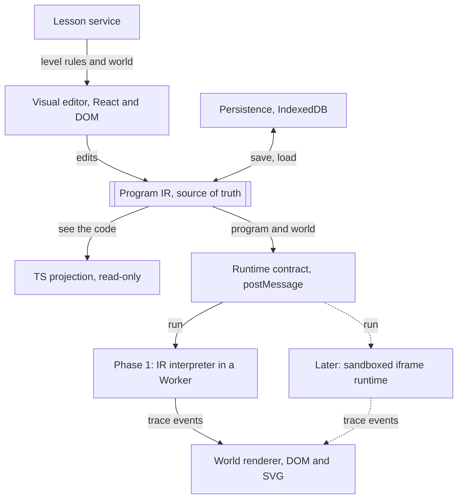
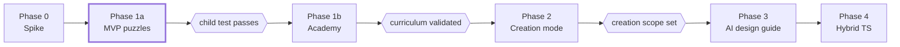

# Visual-First Programming: Revised Product and Technical Plan

> This file is the master copy of the plan. The Claude Doc it started as has
> been retired, and the "Wonderbits: Learning Through Play" doc of 2026-11-08
> is folded in here. Build progress is tracked in
> [design-notes.md](design-notes.md), not here. Revised 2026-11-05: the board
> is top-down 2D, not isometric. Revised 2026-11-08: the full concept spine,
> concept introductions and the card book, creation mode and the AI design
> guide (sections 1, 2, 4, 5, 7, 8, 9, 10 and 12).

## Decision summary

Build a polished top-down 2D robot-puzzle MVP first, with a visual program IR as the single source of truth and TypeScript shown as read-only "see the code". Validate puzzle play with the first child tester before writing the full curriculum, Game Workshop, or AI features. That validation passed on 2026-11-08 (section 11).

Purpose: approve the product direction and the Phase 1 boundary before handing work to coding agents. This is a personal project for a nephew first; it may later be open-sourced or offered online, so the architecture keeps those doors open without building for them now.

The longer aim, set on 2026-11-08: Wonderbits teaches the full set of ideas a meaningful program needs, including state, data and persistence, entirely through play. Kids meet each concept as a puzzle the old way cannot solve, and they can switch to creating whenever they like. **The graduate** understands the core concepts and building blocks and has used them to create, or recreate, an interactive game of their own. Ideally they can also read and write TypeScript and know how to work with AI. Wonderbits targets ages 9 and up: ages 9 to 12 work through the puzzle packs and start creating, and ages 13 and up reach Phase 4, where the see-the-code panel becomes editable TypeScript.

**What changed from the review draft**

| Area | Review draft | Revised plan |
| --- | --- | --- |
| Source of truth | Annotated TypeScript files with a limited decoder | Visual IR is authoritative through Phase 3; TypeScript is a deterministic read-only projection |
| Phase 1 execution | Compile and run TypeScript in a Worker | Interpreter over the IR; no TypeScript execution until Phase 2 or later |
| Runtime boundary | Worker, with a note that it is not a security boundary | Message-passing runtime contract from day one, so a cross-origin sandboxed iframe drops in later |
| View | 2.5D isometric board | Top-down 2D grid with square tiles; one robot sprite rotated in code for all four facings |
| Turn commands | Turn left, turn right | Rotate clockwise, rotate counter-clockwise, with on-screen rotation cues |
| Renderer | Phaser | DOM and SVG board with CSS animation; a canvas layer only if effects need it |
| Art | Unspecified owner | AI-generated art from a prompt list in this plan, vector style matching the concept sketch |
| Reordering | Menu move up/down, drag optional | Tap a card, tap a slot, as the primary design |
| Phase 2 | Reusable visual editor for game templates, events and game state | Pared back to a modest step up from puzzles; scope defined after MVP validation |
| Phase 3 AI | Structured operations on gameplay | AI hints first; AI output is IR operations, never TypeScript |
| Curriculum | 12 levels fully specified up front | An MVP puzzle set to validate play; the full curriculum is written after validation |
| Missing features | Not listed | Prediction mode, hint ladders, level map with stars and badges, observation logging |
| Curriculum beyond the MVP (2026-11-08) | Repeat, then conditionals, variables, functions and events, written after validation | A 17-concept spine from sequencing to objects, each concept a puzzle mechanic, in 14 proposed packs after the three built ones (section 4) |
| Creation (2026-11-08) | A Phase 2 Workshop, gated on curriculum validation | Creation mode open at any time, from remixing a level to designing a game; the Workshop is its game-modifying part (section 9) |
| AI (2026-11-08) | Hints inside the hint ladder, then a partner proposing IR operations | AI only in creation mode, as a design guide that asks, explains and points to puzzles; puzzle hints stay authored, and the AI never writes the design, the IR or the code (section 9) |

## 1. Decisions approved

| Decision | Position |
| --- | --- |
| Product progression | Puzzle packs along a concept spine from sequencing to objects (section 4); creation mode open at any time, from remixing a level to designing a game; an AI design guide in creation mode only; then a hybrid TypeScript editor. |
| Audience | Ages 9 and up. Ages 9 to 12 play the packs and start creating; ages 13 and up reach the editable TypeScript of Phase 4. |
| First release | An MVP set of sequencing puzzles using Forward, Rotate CW and Rotate CCW. No loops or conditionals. The full curriculum is written only after MVP puzzle play is validated with a child. Built; the Repeat and If packs followed when the first testers asked for more. |
| Puzzles first, never forced | Creation is open anytime. The program encourages finishing the puzzles first and never asks a child to prove mastery. Puzzle progress shapes guidance only; nothing is ever blocked. |
| AI boundary | AI appears only in creation mode. It asks questions, explains concepts, gives small nudges and suggests puzzles. It never writes the design card, the IR or the code. Puzzle hints stay the authored three-rung ladders. |
| Visual standard | Original, polished top-down 2D art, robot animation, sound and interaction feedback in the first child-facing build. Art is AI-generated from the prompt list in section 3. |
| Program model | A versioned visual IR is the executable source. TypeScript is a deterministic read-only projection shown as "see the code". Hand-edited TypeScript arrives in Phase 4. |
| Execution | A deterministic interpreter over the IR produces a bounded trace. No TypeScript compilation or execution in Phase 1. |
| Runtime contract | Runtimes receive a program and world and emit trace events over message passing. Phase 1 runs in a Worker; later untrusted code runs in a cross-origin sandboxed iframe behind the same contract. |
| Rendering | DOM and SVG top-down grid board with CSS animation. No game engine in Phase 1. |
| Cross-platform | Browser-based responsive PWA for iPad, Android tablets, Mac, Windows and Chromebook. Local-first, no accounts. |
| Content model | Logical tiles, actors, themes and lesson constraints defined by data, not hardcoded per level. |
| Editor interaction | Tap a card, tap a slot. Every essential action works with tap and keyboard. Drag is never required. |
| Meta-loop | Level map, stars per level and badges for mastery behaviours. No leaderboard. |

## 2. Product principles

- Learning should feel like a satisfying game. Worlds, animation, sound and feedback are fundamental UX, not launch polish.
- One new concept at a time. Limit choices at first; later use instruction budgets to motivate abstraction.
- Predict and debug, not merely brute-force. Require varied evidence of understanding, not only reaching the goal.
- Create before typing. Children build and modify games visually, with AI help, before text programming.
- No dead-end language. Every visual program has a real TypeScript form the child can read now and edit later.
- Tablet-first interactions. Tap and keyboard cover everything; drag is an enhancement.
- Validate before expanding. The puzzle loop was proven with a child on 2026-11-08. From there a pack ships when its validators pass; play-testing between packs is not required. Creation mode and AI work keep their own gates in section 9.
- Constraints create concepts. Each new idea arrives as the tool that cracks a puzzle, the way the level 15 instruction budget made Repeat feel necessary.
- The puzzle stays the point. Each concept gets a short, show-first introduction, then the puzzles do the teaching. State, variables and saving show up as game mechanics: switches, a memory budget, a robot that sleeps.
- Puzzles first, never forced. Creation is open anytime. The program encourages finishing the puzzles first and never asks a child to prove mastery.
- Small steps into creating. Creation runs from remixing a level to designing a whole game.
- AI guides, the child designs. AI appears only in creation mode. It explains concepts, suggests puzzles and gives small nudges, and it never writes the design or the code for the child.
- Detours back to play. When a design needs a concept the child has not played yet, the program suggests the puzzle that teaches it, then brings them back.

## 3. Visual direction, theme system and art pipeline

The board is a top-down 2D grid of square tiles, seen from directly above. Isometric was dropped because it multiplies the art: every object needs a 2:1 projection, depth sorting, and four facings with a full pose set each. Top-down needs one drawing per object, and the robot is drawn once and rotated in code.

Aim for a recognisable, kid-friendly adventure-game feel: bright readable tiles, a personable robot whose facing is obvious at a glance, subtle world motion, a clear goal marker, and crisp response to every command. The concept sketch's clean flat-vector style still sets the palette and character; it reads well at tablet size and suits SVG delivery.

**Facing and rotation cues**

- Up on the screen is north, and it never changes. Rotate CW turns the robot clockwise on screen, exactly as the word says, which removes the projection confusion isometric risked.
- The robot is drawn pointing up, with an unmistakable front: a headlamp, a nose arrow, or a visor. Code rotates the same sprite 90 degrees per turn.
- A curved arrow shows the direction of rotation during the turn. A forward indicator on the tile ahead shows where Forward will land, and turns red when the move is blocked.
- Fixed camera, no scrolling, no zoom in early puzzles. Every tile is visible at once.

**Theme architecture**

- Separate semantics from presentation. Floor, wall, gap, goal, collectible, hazard, switch and gate are logical elements; each theme maps them to art, sound and effects. The concept spine in section 4 adds pressure plates, crates, drifting logs, patrolling beetles, dark tiles and the backpack; their prompts are written when their packs are.
- Render terrain, overlays, entities and transient effects as separate DOM or SVG layers. Collision, pathing and goals never depend on assets. With no depth sorting, layer order is fixed: floor, overlays, items, robot, effects.
- A theme pack holds SVG or PNG assets, a palette, tile variants, effects, ambient sound and animation timing. One fully polished forest theme plus one small frozen-theme proof.
- Theme swapping preserves the same solution and rule evaluation; animations never change simulation outcomes.

**Asset specification for AI generation**

Every asset is a square, viewed from directly above, on a transparent background, at 256 by 256 px and scaled down in the app. Square top-down tiles are the format image generators handle most reliably.

| Asset | Count | Notes |
| --- | --- | --- |
| Floor tile | 3 variants per theme | Full square, edges tile seamlessly with each other |
| Wall tile | 2 variants per theme | Fills the square; reads as solid and impassable from above |
| Gap tile | 1 per theme | Water, chasm or void; clearly not walkable |
| Goal marker | 1 per theme | Flag or beacon seen from above, centred, about half the tile |
| Collectible | 1 per theme | Small, centred, readable when the robot is beside it |
| Props | 3 to 4 per theme | Decoration for wall tiles: tree canopy, boulder, stump |
| Robot | 1 sprite pointing up, plus 3 expression variants | Neutral, happy and oops faces; rotation and movement are done in code |
| Effects | 3 | Success sparkle, bump puff, step dust; simple 4 to 6 frame sheets |
| UI icons | 8 | Forward, Rotate CW, Rotate CCW, Run, Step, Reset, Undo, Hint |

Generate the robot first, then everything else against it, so the set matches. Expect light cleanup: trim to the square, fix transparency, and check that floor tiles meet without a visible seam.

**Prompt list for ChatGPT image generation**

Use the shared style prefix on every prompt so the set stays consistent.

Style prefix: "Flat vector illustration for a children's game, top-down orthographic view seen from directly above, no perspective, clean geometric shapes, soft pastel palette, subtle shading, no outlines, no text, no watermark, transparent background, square 256 by 256 image, subject centred, light from the upper left."

1. Robot: "[prefix] A small friendly round robot seen from directly above, pointing straight up toward the top of the image. Blue round body, a lighter blue dome in the centre, a bright yellow headlamp at the front edge so the front is obvious, two small stubby arms on the sides. Symmetrical left to right."
2. Robot expressions: "[prefix] The same blue round robot seen from directly above, pointing up, three versions side by side: neutral, happy with a sparkle, and oops with a small spark. Only the dome's face and glow change."
3. Forest floor tiles: "[prefix] Three square grass tiles that tile seamlessly, fresh green with a few small flowers or pebbles, each a slightly different pattern, no border."
4. Forest wall tiles: "[prefix] Two square tiles filled by mossy grey rock seen from above, clearly solid and raised, with a soft shadow along the bottom and right edges."
5. Forest gap tile: "[prefix] One square tile of dark blue pond water with a few ripples and a grassy rim, clearly not walkable."
6. Forest goal marker: "[prefix] A small yellow flag on a pole seen from directly above, the flag cloth spread out to one side, standing on a grass tuft, centred, about half the tile wide."
7. Forest collectible: "[prefix] A single shiny golden acorn seen from above with a soft glow, small, centred."
8. Forest props: "[prefix] Four separate square images seen from directly above: a round green tree canopy, a pine tree canopy, a mossy boulder, a tree stump with mushrooms. Each fills most of its square."
9. Frozen floor tiles: "[prefix] Three square ice tiles that tile seamlessly, pale blue with faint crack lines and a frosted sheen, no border."
10. Frozen wall and gap tiles: "[prefix] Two square tiles filled by snowy rock seen from above, clearly solid, and separately one square tile of dark icy water, clearly not walkable."
11. Frozen goal and collectible: "[prefix] A light-blue flag on a pole seen from directly above on a snow tuft, and separately a single glowing snowflake crystal, each centred."
12. Effects: "[prefix] Three short sprite sheets, six frames each in a horizontal row, seen from above: golden sparkle burst, small grey puff of dust, soft footstep dust ring."
13. UI icons: "[prefix] Eight rounded square app icons in one consistent set: straight up arrow (forward), clockwise curved arrow, counter-clockwise curved arrow, play triangle, single-step footprint, circular reset arrow, undo arrow, lightbulb hint. Bold simple shapes readable at 44 pixels."
14. Level map backdrop: "[prefix] A forest island seen from directly above with a winding path and fifteen evenly spaced round stepping stones along it, space beside each stone for stars, no text."
15. Badge set: "[prefix] Six round achievement badges in one consistent style: a crystal ball (prediction), a wrench (debugging), a compass (navigation), a lightning bolt (efficiency), a map (transfer), a trophy (mastery). Flat vector, gold rim."

**Phase 1 visual-quality gate**

- Robot has expressive idle, move, rotate, success and error states with consistent timing.
- Its front is obvious at every rotation, at tablet size, without reading any text.
- Tiles, walls, gaps and goals are visually distinct at tablet size. Floor tiles show no seams.
- Audio and particles reinforce actions but are never required signals; muted audio and reduced motion are supported.
- No placeholder art in the child-facing build. A small finished world beats several unfinished worlds.

## 4. Learning design

The MVP validates one thing: can a novice fourth grader understand, build, repair and predict short sequential programs on a grid board without verbal coaching. The full curriculum is written after that is answered.

Use PRIMM (Predict, Run, Investigate, Modify, Make), Parsons-style ordering tasks, and worked examples with gradually removed scaffolding. Apply them as varied activity types, not as five compulsory steps in every level. Evidence for PRIMM exists in secondary settings; primary-school application is promising but less established, so direct usability validation is required.

**MVP puzzle set: 15 sequencing levels**

Rotation enters at level 3 so the facing question is tested early. Collectibles enter at level 9 to extend sequencing without new constructs and to give the competitive tester something to optimise.

| Levels | Activity | Commands | Purpose |
| --- | --- | --- | --- |
| 1 to 2 | Run one prepared Forward; tap the tile where the robot will land | Forward | Execution correspondence and the first prediction |
| 3 to 4 | Add one move to reach the goal in two steps | Forward | Assemble in order |
| 5 to 6 | Rotate once, then move | Forward, Rotate CW, Rotate CCW | Facing and rotation cues |
| 7 to 8 | Reorder supplied cards into slots | Forward, Rotate CW, Rotate CCW | Parsons task, tap-a-card-tap-a-slot |
| 9 to 10 | Navigate a corner and pick up one collectible | Forward, Rotate CW, Rotate CCW | Independent sequencing with a sub-goal |
| 11 to 12 | Find and repair one wrong instruction in a pre-filled program | Forward, Rotate CW, Rotate CCW | Debugging |
| 13 | Predict the final tile and facing before running | Forward, Rotate CW, Rotate CCW | Transfer task on a visually different board, no hint by default |
| 14 | Complete a route with two collectibles from an empty program | Forward, Rotate CW, Rotate CCW | Independent construction |
| 15 | Same route under a tight instruction budget | Forward, Rotate CW, Rotate CCW | Efficiency; sets up the motivation for Repeat |

Level numbers and thresholds are a test hypothesis. No level contains loops, conditions, variables or functions.

**Prediction mode**

A level can open in prediction mode before Run is enabled. The child taps the tile where the robot will finish and, on later levels, picks the facing with a rotation chip. The board then runs and compares. A wrong prediction is never a failure; it opens the investigate step with the trace highlighted.

**Hint ladders**

Each level authors a deterministic three-rung ladder: orient attention (highlight the relevant board region), identify the instruction (highlight the step that matters), partial scaffold (fill one slot). The solution is never given. Hint requests are logged per level.

**Mastery evidence**

- Measure prediction accuracy, debugging success, independent construction and transfer; do not equate trial-and-error completion with mastery.
- Keep instruction efficiency optional during basic mastery. Hard caps only on levels with a verified solution and a teaching purpose.
- Stars per level: one for completion, one for no hints, one for within budget. Badges for behaviours across levels, listed in section 8.

**Prediction grows with the spine.** Later packs ask the child to predict the robot's memory card, field by field, not only its tile. See "Two supporting features" below.

**Curriculum: the concept spine**

Repeat was motivated by the instruction budget the child felt on level 15, and the packs through Tick tock (time and the game loop) are built. The spine continues from there to data. Functions came next after conditionals. Switches then introduce world state on its own, and events follow right after, so the world can react to the robot. Input and the game loop follow events, and lists, grids and randomness follow variables, because the target game types depend on them. Types run as a thread from Representation onward, and Robot team adds objects at the end. A construct is introduced only after a concrete puzzle makes the previous approach cumbersome.

| # | Concept | Pack | Status |
| --- | --- | --- | --- |
| 1 | Sequencing | Forest and Forest trails, consolidating to 15 | Built |
| 2 | Loops | Around and around | Built |
| 3 | Conditionals | Look before you leap | Built |
| 4 | Functions | Same trick, new place | Built |
| 5 | World state | Flip the switch | Built |
| 6 | Events | When it happens | Built |
| 7 | Player input | Remote control | Built |
| 8 | Time and the game loop | Tick tock | Built |
| 9 | Representation and kinds of values | Two things to remember | Proposed |
| 10 | Variables | Into the dark | Proposed |
| 11 | Lists | In a row | Proposed |
| 12 | 2D grids | Reading the map | Proposed |
| 13 | Randomness | Never the same twice | Proposed |
| 14 | Stored vs. derived | Two scoreboards | Proposed |
| 15 | Persistence | Overnight | Proposed |
| 16 | Records and shapes | The notebook | Proposed |
| 17 | Objects: blueprints and instances | Robot team | Proposed |

Inheritance stays out of the puzzle curriculum. It is the least essential part of classes, and TypeScript style leans toward interfaces and composition. If it appears at all, it belongs in Phase 4.

**Concepts as puzzle mechanics**

Each new concept is a rule of the world that makes the previous approach fail. The child discovers the idea by needing it. Every mechanic reuses the existing activity types: predict the memory card, debug a bad save, reorder a notebook, build under a memory budget.

| Mechanic | Concept | What makes it a puzzle |
| --- | --- | --- |
| Named moves | Functions | The same little route shows up in several places that Repeat cannot reach. Naming it once and calling it is the only way under the budget. |
| Switches and gates | World state | Toggle switches open and close a gate, so stepping on one twice undoes it. The route depends on tracking the gate. |
| When cards | Events | Pressure plates and acorns trigger handlers. The child writes what happens when, then predicts the order things fire. |
| Remote control | Player input | Each level comes with a scripted list of key presses, and the goal is getting the event handlers right. The child writes what each key does, places the flag where the robot should end, and runs the script. Correct handlers land the robot on the expected tile, the same way prediction levels work today. |
| Moving hazards | Time and the game loop | Logs drift and beetles patrol one step per tick. The robot can wait, and every-tick rules move the world. Timing the crossing is the puzzle. |
| Memory budget | Representation | The robot can only remember two things. Choosing what to store is the challenge, like the instruction budget for loops. |
| Shaped slots | Kinds of values (types) | Each memory slot only accepts one kind: number, yes/no, direction or position. Debug levels hide a yes/no in a counter; predict levels ask for the kind before the value. |
| The dark | Variables | Tiles go dark after the robot passes, or a gate needs three acorns. The robot must remember what it saw or count what it holds. |
| Rows of crates | Lists | Crates sit in a numbered row. The robot checks each in turn, counts matches, or finds the first one that fits. |
| Reading the map | 2D grids | The robot gets the board as rows and columns. It counts walls around a tile, minesweeper-style, or finds its way by coordinates. |
| Never the same twice | Randomness | Acorns and walls shuffle every run, and one program must work every time. Programs that memorise a route fail; general ones pass. |
| Two scoreboards | Stored vs. derived | A debug level where two stored values disagree. The fix is deleting one and calculating it from the other. |
| Overnight | Persistence | A two-run puzzle. The robot explores on day one, then sleeps, and only its backpack survives. Day two must succeed with what was saved. |
| The notebook | Records and shapes | Labelled crates that all share one shape: label, colour, contents. A crate missing a field breaks the search, which shows why the shape matters. |
| Robot team | Objects | Several robots built from one blueprint, each with its own position and memory. Changing the blueprint changes every robot, and robots must coordinate to flip switches for each other. |

Two supporting features make state visible:

- **The memory card.** A panel beside the board listing what the world holds: position, facing, acorns, gate open, each with an icon for its kind (number, yes/no, direction, position). The trace already carries before and after state, so this is mostly rendering.
- **State prediction.** Prediction mode grows from tile and facing to the whole memory card. This is the freeze-frame exercise built into the game.

**Proposed packs**

Fourteen packs follow Look before you leap, at least ten levels each, like the existing packs. Each closes on a level the next pack's idea makes easier, so the chain of "the old way hurts" continues.

| Pack | Opens with | Closes with, and what it sets up |
| --- | --- | --- |
| Same trick, new place | One L-shaped hop appears twice on the board; name it once and use it twice | The same detour in four spots at different facings, under a tight budget. Sets up: a world that changes. |
| Flip the switch | One switch, one gate, predict whether the gate is open after the run | A route through three toggles where the order matters, and the robot must backtrack to flip them. Sets up: the world should react on its own. |
| When it happens | A pressure plate with a "when stepped on" card that opens the gate | Several handlers (a plate opens one gate, an acorn grab closes another) whose firing order the child predicts. Sets up: a player who reacts too. |
| Remote control | A script of three Up presses; write what Up does so the robot ends on the flag | A long script using only two keys, so each handler must do more than one move. The child predicts the end tile before running. Sets up: a world that moves without the player. |
| Tick tock | A log drifts one tile per tick; wait for it, then cross | A Frogger-style crossing with three lanes at different speeds. Sets up: too much to track in your head. |
| Two things to remember | Fill in the memory card for a paused robot, matching each value to its kind | A level where only two slots fit, the obvious pair fails, and the right pair needs a different kind of slot. Sets up: the robot needs to change what it remembers. |
| Into the dark | Count acorns with a counter card to open a three-acorn gate | Dark tiles the robot must remember to avoid on the way back. Sets up: more things than slots, all alike. |
| In a row | Find the first crate with an acorn in a row of five | Count how many crates match and open the gate with that number. Sets up: rows stacked into a whole board. |
| Reading the map | Read from the map which tiles around the robot are walls | A minesweeper-style board where the robot marks each tile with how many hazards touch it. Sets up: boards that change every time. |
| Never the same twice | Acorns move each run, and one program must collect them all | A shuffled maze where only a general wall-follower works on every shuffle. Sets up: values that can drift apart. |
| Two scoreboards | Debug a robot whose "acorns held" and "acorns left" disagree | Predict which stored value goes wrong first. Sets up: what should outlive a run? |
| Overnight | Choose what goes in the backpack before the robot sleeps | A three-day route where day three depends on what days one and two saved. Sets up: too many saved things to scan. |
| The notebook | Find the crate with the key from a list of crates that share one shape | Answer a riddle that needs two lists joined by a crate number. Sets up: many things that each remember and act. |
| Robot team | Two robots from one blueprint, started in different places, each reaching its own flag | Robots coordinate: one holds a plate open while another passes, each with its own backpack. Sets up: building games full of things that act. |

Within each pack the mix follows the existing pattern: run and predict early, then build, reorder, debug, a transfer level with no hints, and a budget level last. Exact level lists are written pack by pack as each is built.

Ten levels is a floor. When play shows a concept needs more practice, it gets a second pack or optional practice trails on the map. Sequencing went the other way: on 2026-11-08 its 25 levels (Forest's 15 and Forest trails' 10) were consolidated to 5 intro levels in Forest plus 10 real ones in Forest trails, keeping the 22-card square as the closer that motivates Repeat. The 5 intro levels teach the game itself (the board, the cards, Run and the flag) and are not repeated in later packs.

**Introducing each concept**

Every new concept opens with a short introduction that shows before it tells, then hands off to the puzzles. It takes under a minute and can be replayed anytime.

- **Show.** A 10 to 20 second animated demo of the robot using the new card, readable without text.
- **Name it.** One sentence in kid terms, beside the new card.
- **Peek at the code.** The same idea as one line in the see-the-code panel.
- **First try.** Every pack's first level introduces its concept in the most straightforward way: one new card, an obvious use, and nothing else to figure out.
- **Save it to the card book.** The demo, sentence and code line go into a card book the child can open anytime, from puzzles or creation mode.

| Concept | Kid explanation | Intro demo |
| --- | --- | --- |
| Sequencing (built) | The robot does your cards in order, one at a time, top to bottom. | The cards light up one by one as the robot moves with each. |
| Loops (built) | A Repeat card runs the cards inside it again and again. | Four Forward cards squeeze into one Repeat 4 card, and the robot walks the same path. |
| Conditionals (built) | An If card checks the world first, then picks what to do. | The robot pauses with a thought bubble asking "blocked ahead?", hears yes, and turns. |
| Functions | Give a set of moves a name, then use the name anywhere. | The robot does a hop, and its cards fold into one card called Hop. |
| World state | Things in the world can change, and they stay changed until something changes them back. | The robot steps on a switch and the gate opens; it steps again and the gate closes. |
| Events | A When card waits for something to happen, then runs its cards. | A pressure plate is pressed and the gate opens on its own. |
| Player input | Each key can have its own When card. | Scripted key presses light up one by one as the robot responds. |
| Time and the game loop | The world moves one tick at a time, and Every tick cards run on each tick. | A log drifts across the water while a clock ticks. |
| Representation | The robot can only remember a few things, so choose what matters. | The memory card fills as the robot moves, then runs out of room. |
| Kinds of values | Each slot holds one kind of thing: a number, a yes/no, a direction or a place. | Shapes snap into matching slots and bounce off the wrong ones. |
| Variables | A named slot can change while the program runs. | A counter ticks up as each acorn is picked. |
| Lists | A list keeps many things in order, and you can check each one. | The robot walks a row of crates while the list highlights each item. |
| 2D grids | A grid is rows of lists, and every tile has a row and a column. | The board lines up with a grid of row and column numbers. |
| Randomness | Shuffled levels change every time, so your program must work for any version. | Run is pressed three times and the board reshuffles each time. |
| Stored vs. derived | If you can work it out, you don't need to store it. | Two scoreboards drift apart until one is replaced by a calculation. |
| Persistence | Only what's in the backpack lasts until tomorrow. | The robot sleeps, the memory card empties, and the backpack stays full. |
| Records and shapes | A record is a thing with named parts, and every crate has the same parts. | A crate opens to show its label, colour and contents. |
| Objects | A blueprint makes robots, and each robot keeps its own memory. | One blueprint stamps out two robots that walk off in different directions. |

Explanations stay short enough for a 9-year-old to read, and the demo carries the rest. In creation mode, the AI's explanations link to the same card book page. The three packs built before step 8 have theirs, replacing the single `intro` sentence their first levels used to carry, and Same trick, new place shipped with its own (built 2026-11-08; see design-notes.md).

A pack's introduction lives in its `pack.json` beside `concepts` and `prerequisites`: a `title`, one `explanation` sentence, and a `demo` with a small board and the `program` the robot plays on it, plus an optional `before` program that shows the old way first and folds into the new one. The code shown is printed from the demo program by the same projection as the see-the-code panel, so the three parts of the introduction can never disagree. The validator proves the demo reaches the flag, that the old way is the longer one, and that the program uses a card of the concept it introduces.

## 5. Puzzle rules and lesson schema

Each level declares its allowed instructions, maximum total instruction nodes, optional per-command quotas, starter program, goals, prediction settings, hint ladder, scoring and teaching activity. The editor hides irrelevant commands and shows remaining capacity.

```typescript
interface PuzzleDefinition {
  id: string;
  themeId: string;
  world: WorldDefinition;            // tiles, walls, collectibles, start pose
  objective: ObjectiveDefinition;    // reach goal, collect all, final facing
  curriculum: { concept: string; activity: 'run' | 'build' | 'reorder' | 'debug' | 'predict' };
  programming: {
    allowedCommands: CommandId[];
    maxInstructions?: number;
    maxPerCommand?: Partial<Record<CommandId, number>>;
    maxNestingDepth?: number;        // in use since the Repeat pack
    starterProgram?: IRNode[];
    suppliedCards?: CommandId[];     // Parsons levels
  };
  prediction?: { askTile: boolean; askFacing: boolean };
  hints: [HintStep, HintStep, HintStep];
  referenceSolution: IRNode[];       // required on every level
  stars: { noHints: boolean; budget?: number };
}
```

Instruction count means program nodes, including a Repeat node and its body later, not runtime actions. Executed operations are reported separately.

Planned additions for the concept spine (section 4): a `model` activity, where the child fills in or predicts the memory card; `maxMemory`, a memory-slot budget with a kind per slot; `persistAcross`, for two-run levels where only the backpack survives between runs; `inputScript`, a scripted list of key presses for input levels; a seed for shuffled levels; and in `pack.json`, the concepts a pack teaches, its prerequisites, and its introduction (demo, kid sentence and code line) for the card book. That concept graph is what creation mode reads to suggest detours. Validators grow with the schema: a design card is sufficient for the objective and the checks, and a shuffled level passes across many seeds.

Validators run in CI on every level: the reference solution reaches the objective within the declared limits; for sequencing levels an exhaustive search confirms the minimum instruction count used for the budget star; allowed commands cover the reference solution; hint targets refer to real steps and tiles.

## 6. Visual editor and interactions

The program is an editable vertical sequence of instruction cards with insertion slots. Early levels present fixed slots; later levels reveal insertion, nesting and parameters. A contextual command palette shows only the commands the level permits. The board and the program are visible together on landscape tablets and desktops; portrait tablets stack board over editor with a compact command drawer.

**Tap a card, tap a slot**

Selection is the primary model for every placement and move. The child taps a card in the palette or in the program; it lifts and the valid slots glow. Tapping a slot places it. Tapping the same card again, or anywhere else, cancels. Moving a card within the program is the same gesture: tap the card, tap the destination slot. Drag is an enhancement layered on the same slots and is never required.

| Interaction | Touch and mouse | Keyboard |
| --- | --- | --- |
| Add step | Tap a palette card, tap a slot | Focus palette card, Enter, arrow to slot, Enter |
| Move step | Tap a program card, tap a slot | Focus card, Space to lift, arrow to slot, Space |
| Reorder supplied cards (Parsons) | Same tap-card-tap-slot gesture | Same keys |
| Delete | Tap card, tap the trash slot | Focus card, Delete |
| Undo and redo | Toolbar buttons | Cmd or Ctrl+Z, Shift+Cmd or Ctrl+Z |
| Run, step, pause, reset | Toolbar | Cmd or Ctrl+Enter runs; toolbar is keyboard reachable |
| Predict | Tap a board tile; pick a facing chip | Arrow across tiles, Enter; Tab to facing chips |
| Hint | Tap the lightbulb | H |
| See the code | Toggle panel | C |
| Nest (later) | Tap a Repeat card, tap a slot inside it | Arrow right and left to enter and leave |

Minimum hit targets are 44 by 44 CSS px. No essential function is hover-only. Every card and slot is a real DOM element with a label, so screen readers and keyboard focus work without extra work.

**Execution model**

Every executed instruction emits a typed, deterministic trace event with node ID, before and after world state, and result. The renderer plays the trace through robot animation and card highlighting. Run computes the whole bounded trace in the runtime, then replays it; Step advances one event. Editing after a run resets playback. An invalid move stops the trace, highlights the card, and explains what happened in one short sentence.

## 7. Architecture and contracts

The program IR is the single source of truth. Everything else is a view of it, a store for it, or a consumer of it. This is the main change from the review draft and it removes the TypeScript compiler, the round-trip decoder, and the sandbox question from Phase 1 without closing any later door.



The editor writes the IR, the IR is printed to TypeScript and sent to whichever runtime is behind the contract, and only the trace reaches the renderer. Dashed lines are a later phase behind the same contract. The renderer also highlights the editor card for each trace event.

**Program IR**

- A versioned JSON document: a list of named procedures and event handlers, each a tree of nodes with stable IDs. Phase 1 shows only `main`, but the shape is there so Game Workshop events need no migration.
- Node kinds today: `forward`, `rotateCW`, `rotateCCW`, `wait`, `repeat`, `if`, `ifElse`, `until`, `call`, which runs one of the program's functions (each a procedure beside `main`), and `openGate` and `closeGate`. When cards are the IR's event handlers: stepping on a plate, picking up an acorn, a key press from the level's script, and every tick. Next, in spine order: `set` and a named, typed memory-slot list per level for variables, and blueprints and instances for Robot team.
- Every edit is an operation on the IR, which gives undo, redo, and later AI operations the same path.

**TypeScript projection**

- A pure, deterministic printer from IR to readable annotated TypeScript, with a comment carrying the node ID on each statement.
- Shown read-only in a "see the code" panel from Phase 1. The same panel grows into the Phase 4 editor.
- Tested by snapshot: the same IR always prints the same text. No parser until Phase 4.

**Runtime contract**

- A runtime is anything that accepts `{ program, world, limits }` over `postMessage` and emits trace events `{ nodeId, before, after, result }` until it reports `done` or `halted`.
- Phase 1 runtime: an IR interpreter in a Worker, with instruction and time limits.
- Later runtimes: the same interpreter extended for loops and conditions; then a cross-origin sandboxed iframe for code that is not generator-owned. The app never changes.
- When TypeScript execution arrives, differential tests compare its trace to the interpreter's on the same programs.

**Layers**

| Layer | Responsibility | Boundary |
| --- | --- | --- |
| Project core | Versioned project, IR, metadata, progress. Local-first through a storage interface over IndexedDB. | No network, no accounts |
| Visual editor | Generic node descriptors, slots, selection, history, parameter controls. | No puzzle-specific assumptions |
| TS projection | Print IR to TypeScript. | No parsing |
| Puzzle simulation | Pure grid state transitions, robot API, objective checks, traces. | No rendering code |
| World renderer | Top-down grid layout, fixed layer order, animation, effects, in DOM and SVG. | Consumes trace only |
| Lesson service | Level definitions, constraints, prediction, hints, validation, progression. | Data-driven |
| Meta-loop | Level map, stars, badges, observation log. | Reads progress only |

**Architecture fit for the concept spine and creation mode**

Most of the 2026-11-08 additions extend modules that already exist, and the IR-as-source-of-truth rule holds throughout.

| Area | Change | Builds on |
| --- | --- | --- |
| Simulation | Switches and gates as mutable world state; senses for gate open and switch on; hazards that move on a tick; seeded randomness so every trace stays reproducible | `sim/world.ts`, the theme's logical elements (switch and gate are already named) |
| IR | `call` for functions and `on` handlers for events, input and ticks (built), `set` for variables; a named, typed memory-slot list per level; blueprints and instances for Robot team | The planned `call`, `on` and `set` kinds; `ir/ops.ts` edit operations |
| Memory card | A panel rendering the world and robot state from trace events, with each field's kind; the code panel prints shapes as TypeScript interfaces | Trace before and after state |
| Prediction | Predict the memory card, field by field | `lessons/prediction.ts` |
| Lesson schema | `model` activity; `maxMemory` budget; `persistAcross` for two-run levels; `inputScript` of key presses for input levels | `PuzzleDefinition`, validators in CI |
| Validator | Check that a design card is sufficient for the objective and the checks; run shuffled levels across many seeds | `lessons/validate.ts` |
| Concept graph | Each pack declares the concepts it teaches, its prerequisites and its introduction (demo, explanation, code line) for the card book | `pack.json` |
| Puzzle progress | Packs finished per concept, used only to suggest detours | `progress/store.ts`, observation events |
| Persistence | Backpack saves between runs, kept in IndexedDB | Storage interface |
| Workshop | Design card, save-my-place for detours, starter games for turn-based and real-time play, grown-up review before anything is shared | Settings screen, progress export |
| AI guide | A Phase 3 service behind a flag, in creation mode only; returns questions, explanations, nudges and puzzle ids | Section 9, Phase 3 |

Gap detection is rules first: a design card that stores a count needs the variables concept, and the concept graph says which pack teaches it. The AI handles the conversation on top of those rules, which keeps it testable and keeps the curriculum in the content files.

**Technology**

React, TypeScript and Vite for the responsive PWA. Board rendered with DOM and SVG on a square grid, CSS transforms to move and rotate the robot, and CSS or Web Animations for motion. A small canvas layer only if particle effects need it. IndexedDB storage with a progress export. No Phaser, no TypeScript compiler in the bundle, no CodeMirror until Phase 4.

**Safety and performance**

- Only the IR vocabulary executes in puzzles. Per-run limits on instructions and time; runaway work is terminated.
- Frame-rate and memory checks on a real iPad, not only desktop emulation.
- Safari evicts storage for a PWA that is not installed to the home screen after seven days of disuse. Alpha accepts this risk and offers a one-tap progress export; later releases add accounts if the project goes public.

## 8. Meta-loop and observation

The level map is the home screen. It shows the island path with one stepping stone per level, stars earned, the next unlocked level, and the badge shelf. This is the hook that answers "do they voluntarily continue", and it is in scope for the MVP.

**Stars**

| Star | Earned when |
| --- | --- |
| Complete | The objective is met |
| No hints | Completed without opening the hint ladder |
| Budget | Completed within the level's instruction budget, where one is set |

**Badges**

| Badge | Behaviour it rewards |
| --- | --- |
| Crystal ball | Three correct predictions in a row |
| Wrench | Repaired a wrong instruction on the first run |
| Compass | Five levels in a row with no facing errors |
| Lightning | Three budget stars |
| Map | Solved a transfer level with no hints |
| Trophy | All stars on the MVP set |

Badges reward mastery behaviours, not speed. No leaderboard and no timers.

**Create on the map**

The map always shows Create, with a gentle nudge toward the next unfinished pack. Every card is available in creation mode; cards from unplayed packs carry a link to the pack that teaches them. Finishing a pack celebrates the new tools it brings to creation mode. Puzzle progress shapes guidance only: the AI uses which packs are finished to decide when to suggest a detour, and nothing is ever blocked. The card book (section 4) opens from the map, from a level and from creation mode.

**Local progress**

Progress, stars, badges and per-level attempt history live in IndexedDB behind the storage interface. A settings screen offers mute, reduced motion, theme choice, and a one-tap export of progress and the observation log as a JSON file.

**Observation log**

Every session appends structured events locally: level opened, card placed, card moved, run started, trace halted at node, prediction made and outcome, hint rung opened, level completed with stars, level abandoned. Each event carries a timestamp and level ID. The export is the data source for the child-test checks in section 11. Nothing leaves the device unless the adult exports it.

## 9. Delivery phases and boundaries

Each phase has a hard boundary and a gate. The MVP child test passed on 2026-11-08, and Phase 1b is specified in section 4.



Phase 1a is built. The first three packs of Phase 1b (Forest trails, Around and around, Look before you leap) followed early because the first testers finished the 15 MVP levels and asked for harder ones (see design-notes.md). The child test passed on 2026-11-08. The remaining gates are curriculum validation and a written creation-mode scope; play-testing between packs is not required. Bands are not to scale; effort is not estimated.

| Phase | Core deliverable | Explicitly not included |
| --- | --- | --- |
| 0 Spike | IR schema, interpreter, trace, TS printer with snapshot tests; DOM and SVG board with one tile set and the robot on a real iPad; runtime contract over postMessage | Lessons, editor polish, sound, second theme |
| 1a MVP puzzles | Polished forest world; 15 sequencing puzzles; tap-a-card-tap-a-slot editor; prediction mode; hint ladders; level map, stars and badges; observation log and export; see-the-code panel | Loops, conditions, AI, workshop, accounts |
| 1b Puzzle Academy | The concept spine of section 4, pack by pack: functions, world state, events, player input, time, representation and kinds of values, variables, lists, grids, randomness, stored vs. derived, persistence, records, objects. Concept introductions and the card book; the memory card and state prediction; sequencing consolidated to 15 levels; frozen theme completed | Arbitrary game creation, text editing, inheritance |
| 2 Creation mode | Open at any time, in four sizes: remix a finished level; design a puzzle for someone else on the same device, with the validator as critic; modify a small pre-built game in the Workshop (turn-based and real-time starters); design a game from a design card. Save-my-place for detours into puzzles. A grown-up reviews anything before it is shared | General game builder, physics, sprite editor, AI generation, sharing beyond the device (waits for accounts) |
| 3 AI design guide | In creation mode only, behind a flag: Socratic questions, kid-terms explanations linked to the card book, small nudges, gap detection against the concept graph with suggested puzzle detours, and noticing what the child figured out. Gap detection is rules first; the AI handles the conversation | AI in puzzle hints, AI writing the design card, the IR or the code, custom LLM infrastructure |
| 4 Hybrid TypeScript | The see-the-code panel becomes editable: a parser lifts hand-written TypeScript into the IR, unsupported statements stay as explicit code blocks, type tutoring, sandboxed iframe runtime for user code. Aimed at ages 13 and up | Any requirement to abandon visual mode |

**Creation mode**

Creation is a separate mode a child can enter at any time, with no gate and no mastery test. The program encourages finishing the puzzles first, and the puzzles stay one tap away (section 8, Create on the map).

Four ways to create, smallest to largest:

1. **Remix.** Change a finished level's board or budget and solve your own version.
2. **Design a puzzle.** Build a level for someone else to play on the same device. The validator is the critic: is it solvable, what is the shortest solution, does a flat program sneak under the budget?
3. **Modify a game.** In the Workshop, change the rules of a small pre-built game, such as tic-tac-toe or a Frogger-style crossing.
4. **Design your own game.** Start from a design card: what the game must know, what changes it, what must survive a restart. Then build it.

Puzzle design is the key bridge. It is still a challenge with a clear goal, it forces the child to think about the world as data, and the validator gives honest feedback without AI.

The robot is the platform for puzzles, and creation is not limited to it. Kids can build or recreate games of many kinds, and possibly other interactive programs. The Workshop's starter games cover both families below, so a child can recreate a classic or invent something new.

| Family | Examples | What they demand |
| --- | --- | --- |
| Turn-based | Tic-tac-toe, Connect 4, minesweeper, solitaire | Boards as data, turns, win checks, hidden information, shuffling |
| Real-time | Pac-Man, Q*bert, Frogger | Player input, a game loop over time, moving actors, collisions |

Sharing beyond the device comes later, with accounts. A grown-up reviews anything before it is shared.

**The AI design guide**

The AI lives only in creation mode; puzzle hints stay the authored three-rung ladders. Its job is to ask good questions, explain concepts and point to puzzles. It reads the child's design card and comments on it, and it has no way to write the card, the IR or the code.

What it does:

- Asks Socratic questions. "When the player closes the game, what should still be there tomorrow?" "How will the game know the gate is open?"
- Explains concepts. When a child asks what a variable or an event is, it explains in kid terms and links the puzzle where the robot used it.
- Gives small nudges. When a variable or a check would help, it may say "You might need to store…" or "Check for… before…" without naming the exact field or steps.
- Spots gaps and suggests puzzles. When a design needs a concept the child has not played yet, it names the puzzle that teaches it.
- Notices what the child figured out. It points to the good decisions in their design so the child knows what worked.

The detour loop:

1. The child adds something to the design card, such as a score that survives closing the game.
2. The program checks the concept graph: this needs persistence, and Overnight is not finished.
3. The AI says so in kid terms: "Your game needs to remember the score while it sleeps. The robot learned that in Overnight. Want to try it?"
4. The Workshop saves the child's place, and they play the puzzle pack.
5. On return, the AI picks up with the same question, and the child finishes that part of the design.

Constraints on its output:

- Questions, explanations, nudges and puzzle references, with puzzles chosen from the content catalogue.
- Nudges name the kind of idea (store something, check something first) and never the exact field name, value or program steps.
- Never writes to the design card, the IR or the code.
- Short sentences at the child's reading level.

## 10. Build sequence for agent delivery

Work proceeds vertically: each step ends with something runnable on an iPad. Coding agents build; the art is generated in parallel from section 3 and dropped in at step 5.

1. **Decide before code.** Confirm the three pivots in writing: IR as source with TS projection; top-down 2D view with rotation cues; AI art from the prompt list. Generate the robot first, since every later asset must match it.
2. **Vertical slice.** IR schema with stable node IDs; interpreter with trace events and limits; TS printer with snapshot tests; runtime contract over postMessage with the interpreter in a Worker; DOM and SVG board with one tile set and a temporary vector robot; Forward only; Run and Reset by tap and keyboard. Measure frame rate and load time on a real iPad. First built with an isometric board, then moved to the top-down grid.
3. **Editor and rotation.** Rotate CW and CCW with the curved-arrow cue and next-tile ghost; tap-a-card-tap-a-slot for add, move and delete; palette constrained by level; undo and redo; Step and Pause; landscape and portrait layouts; full keyboard parity. Quick facing check with the nephew on two throwaway boards.
4. **Lessons and meta-loop.** Lesson schema and validators in CI; prediction mode; hint ladders; the 15 MVP levels with reference solutions; level map; stars and badges; IndexedDB progress; observation log and export; see-the-code panel.
5. **Polish.** Final AI art, robot movement and rotation animation with expression changes, sound with mute, reduced motion, success and error effects, frozen theme smoke test proving the same trace under both themes, onboarding without words on level 1.
6. **Child test.** Run the section 11 protocol. Fix usability failures. Re-test the fixed levels.
7. **After the gate.** Repeat, motivated by the level 15 budget, then If. Started early: the first testers finished the 15 levels and asked for more, so the Forest trails, Around and around and Look before you leap packs exist (design-notes.md). The child test in step 6 passed on 2026-11-08.
8. **Concept introductions and the card book.** Show, name it, peek at the code, first try, save it to the card book. The three built packs get theirs, replacing the `intro` sentence on their first levels. Concepts, prerequisites and the introduction go into each `pack.json`. Sequencing consolidates to 5 intro levels plus 10. Built 2026-11-08 (design-notes.md).
9. **Functions.** `call` in the IR, the printer and the interpreter; the Same trick, new place pack with its introduction. Built 2026-11-08 (design-notes.md).
10. **World state and the memory card.** Switches and gates in the simulation with their senses; the memory card panel rendered from trace state; the Flip the switch pack; the `model` activity and state prediction with their validator rules. Built 2026-11-08 (design-notes.md).
11. **Events, input and time.** `on` handlers and When it happens; `inputScript` and Remote control; ticks, every-tick handlers, moving hazards and Tick tock. Built 2026-11-08 (design-notes.md).
12. **Data.** The memory budget and kinds of values (Two things to remember); `set` and variables (Into the dark); lists (In a row); 2D grids (Reading the map); seeded randomness (Never the same twice); stored vs. derived (Two scoreboards); the backpack and persistence (Overnight); records (The notebook); blueprints and instances (Robot team).
13. **Creation mode.** Create on the map with its nudge; remix; design a puzzle with the validator as critic; the Workshop's turn-based and real-time starters; the design card and save-my-place for detours; grown-up review.
14. **AI design guide.** Gap detection by rules over the concept graph first, then the AI conversation behind a flag, in creation mode only.

Steps 9 to 14 are the order of the spine, not a commitment to dates. A pack ships when its validators pass; play-testing between packs is not required (owner's decision, 2026-11-08).

Agents must keep the module boundaries in section 7, write tests for the interpreter, printer, validators and editor operations, and record any deviation from this plan in a short design note in the repository.

## 11. Validation plan and exit gate

The MVP gate is about usability, not learning efficacy. One or three children cannot show that learning happened; they can show where the editor, the board or the progression breaks.

**Technical checks**

- The same puzzle and program produce identical traces under both themes and after a reload.
- The TS printer produces identical text for identical IR, and every node ID appears once.
- Allowed-command rules and instruction budgets are enforced in the UI and in the runtime.
- Every level's reference solution passes its validator in CI; no budget level ships without one.
- Run, Step, Pause and Reset never diverge from the precomputed trace; no frozen UI on long or invalid programs.
- iPad touch and Mac keyboard cover every editing, prediction and hint action.
- Load time, frame rate and memory measured on a real iPad and a low-end Chromebook.
- Progress and the observation log survive a reload and export as JSON.

**Child-test protocol**

- First tester: the nephew, a fourth grader with no coding experience. Add two more children near the target age when possible. The adult observes and does not coach except where the level explicitly expects it.
- Session length: one sitting until the child stops or finishes. Record the stopping point.
- The observation log plus written notes capture every mistaken move, and whether it was caused by facing or by program logic.
- After the session, ask the child to explain what three programs do, to distinguish understanding from guessing.

**Exit gate for Phase 1a**

Passed 2026-11-08.

- [x] Level 1 completed with no verbal explanation.
- [x] Rotation cues work: no more than one facing error per five rotations after level 6.
- [x] The child places, moves and deletes cards with the tap-a-card-tap-a-slot gesture without being shown.
- [x] At least one correct prediction, one successful repair, and one independent route from an empty program.
- [x] The child can explain, in their own words, what a three-step program will do.
- [x] The child asks to continue, or returns for a second session unprompted.
- [x] No technical check above fails on the iPad build.

Repeat and If were built before this gate because the first testers asked for more. With the gate passed, play-testing between packs is not required; creation mode and the AI guide keep their own gates in section 9.

## 12. Open decisions and agent handoff contract

**Still open**

| Decision | Proposed default | Resolve by |
| --- | --- | --- |
| Licensing | MIT for code; CC BY 4.0 for curriculum, puzzles and themes; CC0 with a note for AI-generated art; project name kept as a trademark and stated in the README. LICENSE file in the first commit | First commit |
| Session length and level count | Resolved 2026-11-08: one sitting; the testers finished the 15 MVP levels and asked for more | Done |
| Creation-mode scope | The four sizes in section 9: remix, design a puzzle, modify a starter game, design a game from a design card; two or three named starter games per family | After Phase 1b |
| AI provider and placement | A design guide in creation mode only, behind a flag; no AI in puzzle hints | Before Phase 3 |
| Public release | Open source or hosted; decided only if the MVP is good | After Phase 1b |
| Sound direction | Subtle feedback, mute and reduced motion from the start; AI-generated or stock library | Step 5 of the build sequence |

**Open questions from the 2026-11-08 review**

- How does creation render games that do not fit the robot's grid, such as solitaire's cards or Q*bert's angled pyramid?
- Is the Workshop the same as creation mode, or the part of it for modifying and designing games? This plan treats it as the part.
- How strongly should the map nudge toward puzzles: a quiet note, or a suggested path?
- Are detours required or suggested? Suggested keeps agency, but some kids will skip and get stuck.
- Resolved 2026-11-08: the memory card appears on every board with gates, from the switch pack's first level, and on any level that asks the child to predict it.
- Resolved 2026-11-08: the trace interleaves. A When card runs right after the step that set it off, before the next card; on a timed board each robot action is followed by one tick, then the Every tick card.
- When accounts arrive, how does the grown-up review work: on the child's device, or from the grown-up's own account?

**Next steps (2026-11-08)**

- [x] Add `call` to the IR and write the Same trick, new place pack (2026-11-08)
- [x] Build the memory card panel from trace state (2026-11-08)
- [x] Add switches and gates to the simulation, then write Flip the switch (2026-11-08)
- [x] Draft the `model` activity schema and its validator rule (2026-11-08)
- [x] Add concepts, prerequisites and the introduction to each `pack.json` (2026-11-08)
- [ ] Define how creation mode nudges toward unfinished puzzles
- [ ] Sketch the Workshop design card and the detour flow on paper with a tester

**Agent handoff contract**

The first agent task is step 2 of section 10: the smallest vertical slice that proves the architecture and the game feel. It delivers a runnable browser application with one puzzle, a Forward instruction, the IR and its TypeScript projection, a bounded deterministic trace from the Worker interpreter, and working tap and keyboard Run and Reset, measured on an iPad.

- Require working code, tests, clear module boundaries matching section 7, and a short design note recording any deviation from this plan.
- Preserve the separation between logical tile semantics, theme assets, lesson constraints and editor command descriptors.
- Add commands, lessons and meta-loop features only in the order of section 10 and only after the previous step passes its checks.
- Never introduce a TypeScript compiler, a game engine, a server, accounts, or AI calls into Phase 1a.
- The repository is empty today; the first commit establishes the project skeleton, the IR schema, and the test harness.

**Community contributions, a note for later**

The project may become a community project where people contribute puzzles, themes and games. Nothing is built for this now, but four cheap habits in Phase 1 keep it easy later.

- Content is data. Puzzles, themes and worlds already live as declarative files with a schema. Keep them in a content directory, never in application code, so a contribution is a pull request that adds files.
- Packs, not a hardcoded list. Levels are grouped by a pack manifest that names its levels, theme and order. The MVP ships one pack. A community pack is another manifest.
- Validators are the review gate. The CI checks in section 5 already prove a level is solvable within its limits. They become the automated review for contributed content.
- Version the schemas. The IR, puzzle and theme schemas carry a version number from the first commit, so old contributions keep loading.

Licensing is settled in the table above and goes into the first commit: MIT for code, CC BY 4.0 for content, CC0 for AI-generated art, with the project name held as a trademark. MIT inbound equals outbound, so contributions need no contributor licence agreement; a Developer Certificate of Origin sign-off is optional. Every planned dependency is MIT. Changing a licence later needs every contributor's consent, so it is decided before anyone outside contributes. One thing still waits for the decision to go public: loading packs from a URL at runtime. Contributed puzzles are pure data and need no sandbox; contributed games with code would go through the sandboxed iframe runtime in section 7.

## References

- [PRIMM approach and instructional sequencing, Digital Technologies Hub](https://www.digitaltechnologieshub.edu.au/teach-and-assess/classroom-resources/topics/programming/)
- [Hodge, Hawkins and Sentance (2026), Adapting PRIMM to a Primary (K to 5) Computing Setting](https://doi.org/10.1145/3772338.3772349)
- [TypeScript compiler API, Microsoft](https://github.com/microsoft/TypeScript/wiki/Using-the-Compiler-API), relevant from Phase 4 only
- Review draft: visual_programming_product_plan_review.docx, dated before 2026-11-03, and the critique discussed on 2026-11-03
